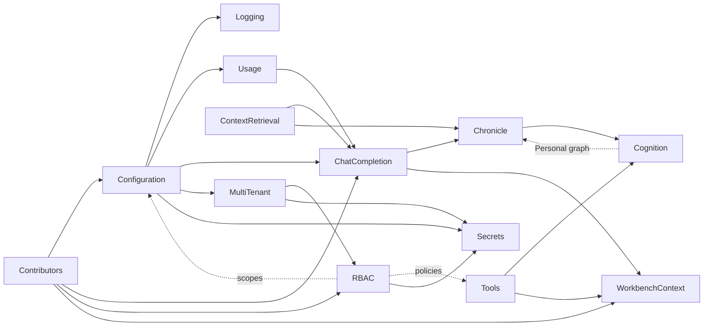

# Build history: dependencies, seams and the tracer-bullet slices

How Foundation was built: the plans' dependencies, the seams that broke their cycles, and the slices built so far, each with what it decided and what it left for later. This is a record. What a feature does now is in its own document ([Index.md](Index.md)), and what is still to do is in [plans/Index.md](plans/Index.md), each plan with its own TODO section. Where this record and a plan's TODO disagree, the plan's TODO is current.

The order is a sequence of **tracer bullets**: thin slices that run end to end through the backend, the REST layer and the UI. Each slice gives the user something real to look at before more is built on it. A slice builds only the part of a plan it needs, and later slices come back to finish it.

## Dependencies

The dotted edges are the **cycles**. Each one is broken with a seam, described below.

## Breaking the cycles
Each cycle is broken by building a **seam** first: a narrow interface or a column that exists from day one. The real implementation then arrives later without touching the callers.

1. **Configuration ↔ MultiTenant/RBAC.** Scopes need identity, and identity's settings (OIDC) live in configuration.
   - *Seam*: the `Configuration` table has its `Scope` column from the start, and v1 writes only `app`.
2. **Every service ↔ RBAC.** Each service must check access, but RBAC comes late.
   - *Seam*: from the first slice, `ServiceArgs` carries a `Principal` (single-user mode: an implicit user and tenant), and every new operation calls `authz.Check`. It allows everything until RBAC lands.
   - New tables get `TenantID`, and `OwnerID` where they are user-owned, even while there is one tenant. Retrofitting ownership later is the expensive path.
3. **Chronicle ↔ Cognition.** *Personal* mode is a Cognition graph, but the node library is shaped by Chronicle's steps.
   - *Seam*: Chronicle's pipeline is first written in Go as separate step functions with typed inputs and outputs (window, retrieve, match, reply, update), each shaped like a node.
   - Cognition then wraps each step as a node, and the built-in *Personal* graph replaces the Go sequence. The same tests prove it behaves identically.
4. **Tools ↔ Cognition.** The `Agent` node runs the tool loop, and tools appear as nodes.
   - *Seam*: `tools.Loop` is built first and called from chat directly. The `Agent` node wraps it later. *Built in slice 8*: chat's `Send` runs the loop, and the `Agent` node (`llm.agent`) wraps it.
5. **ContextRetrieval ↔ Chronicle.** Retrieval fuses Chronicle memory with Volumes.
   - *Seam*: the `retrieval.Source` interface, with only the library (Volumes) source at first.
6. **Contributors ↔ everything.** The registry is needed before any contribution can exist.
   - *Seam*: build the registry with only the points the current slice uses. Convert the hand-wired workbench pieces one at a time, when a slice touches them.
7. **Per-tenant index ↔ the existing index.** Today LanceDB lives in `<data-dir>/lancedb`.
   - *Seam*: the store takes its directory from a resolver. When tenants arrive, the existing directory becomes the default tenant's, with a one-time move.

## Build order: tracer bullets
Each slice ends with something to look at, and the ★ marks where a decision is expected after seeing it.

1. **Seams.** *Built.* A small slice, mostly invisible:
   - the extension registry (frontend and backend) with `workbench.borderTab` and `configuration` (`config.section` on the backend); *built*
   - `Principal` in `ServiceArgs` and the allow-all `authz.Check`; *built*
   - the `TenantID`/`OwnerID` convention (`db.Tenanted`, `db.Owned`, `db.InTenant`); *built*
   - the error and logging conventions: the `logging` builder over `samber/oops`, the request trace middleware (`rest.Middleware`), and `ServiceArgs.Fail`. Every service built afterwards uses them from the start, and the existing services move over. *Built; every existing service has moved over.*
   - DevTools becomes the first `borderTab` contribution, proving the registry. *Built*, with DevTools' Extensions tab listing the browser's and the server's points (`GET /api/v1/extensions/points`, the first operation to call `authz.Check`).
   - What slice 1 decided is recorded in each plan's *Built in slice 1* section: [Contributors.md](Contributors.md#built-in-slice-1), [Logging.md](Logging.md#built-in-slice-1), [MultiTenant.md](MultiTenant.md#built-in-slice-1) and [RBAC.md](RBAC.md#built-in-slice-1).
2. **Settings and levels.** *Built.* ★ the Settings UI.
   - `configservice`, app scope only, with the generic schema form renderer in a Settings border tab; *built*
   - The sections `ai.providers`, `ai.models` (with pricing) and `ai.chat.levels`; *built*. The Gemini key now comes from Settings, and the flag or env var still wins.
   - Usage recording (the provider decorator into `UsageRecord`), with no UI yet; DevTools can show the rows. *Built*, with DevTools' Usage tab.
   - What slice 2 decided is recorded in [Configuration.md](Configuration.md#built-in-slice-2) and [Usage.md](Usage.md#built-in-slice-2).
3. **Logging.** *Built.* ★ the Log Explorer.
   - The VictoriaLogs handler, `scripts/victorialogs.sh`, the `logging` section, and `logsservice`; *built*
   - The Log Explorer with the builder, the LogsQL editor, the histogram and live tail; *built*, with quick filters, *Show this trace*, surrounding records, deep links, and *Show in Log Explorer* from DevTools' Log tab. Saved queries wait.
   - Browser log forwarding (`warn` and above) with a shared trace; *built*. Full logging for one user waits for identity (slice 10).
   - What slice 3 decided is recorded in [Logging.md](Logging.md#built-in-slice-3).
4. **Chat, thin.** *Built.* ★ the chat transcript, composer and level toggle.
   - The AgentOS › Chat editor streams straight from `chatservice`, with no memory; *built*, through the new `conversation` feature's `Send`, with `chatservice` now driven by the chat levels.
   - `Conversation` and `Round` are persisted, and each round's footer shows its tokens and cost; *built*.
   - This converts `workbench.editor`, because Chat and Dashboard are new editors. *Built*: every editor is now a contribution. The Dashboard waits for slice 5.
   - The workbench context store, `useWorkbenchSubject` in the existing editors, and the snapshot sent with `Send` through the `workbench` context provider ([WorkbenchContext.md](WorkbenchContext.md)). Chat can then answer "what is this document about?" with no tools. *Built*, with the snapshot naming what is open (not its content, as proposed).
   - The opt-in debug capture of prompts and replies (Usage question 2); *built*, with DevTools' Usage tab showing a captured call.
   - What slice 4 decided is recorded in [ChatCompletion.md](ChatCompletion.md#built-in-slice-4), [WorkbenchContext.md](WorkbenchContext.md#built-in-slice-4), [Contributors.md](Contributors.md#built-in-slice-4), [Usage.md](Usage.md#built-in-slice-4) and [Configuration.md](Configuration.md#built-in-slice-4).
   - **Blockers**: none. Its one **Before** question (Usage 2) was answered before building.
   - **★ review pending**: the transcript, composer and level toggle still need review with a real model.
     - The build environment had no Gemini API key, so a streamed reply, a generated title and a captured call were never seen in the browser. Every round there ended with the 503 "AI provider is not configured" message, as designed.
     - Set a key in Settings › AI › Providers, then review. See [ChatCompletion.md › Verification of slice 4](ChatCompletion.md#verification-of-slice-4).
   - **Decisions to review after seeing it**:
     - Chat lives in a new `conversation` feature rather than `chronicle`. Chronicle's pipeline will run inside its `Send` in slice 6.
     - Conversations are private to their owner until RBAC.
     - The context controls' defaults are server sections.
     - Each round keeps its own copy of its tokens and cost.
     - The last 50 rounds are sent as plain history until memory arrives.
     - WorkbenchContext questions 1, 2, 3 and 6 are built on their proposals.
5. **Retrieval and feedback.** *Built.* ★ the axis mapping, Top-K and the inspector.
   - The retrieval engine with the library source; *built* (`features/retrieval`, `retrievalservice.Retrieve`, `POST /retrieval/retrieve`), with the RRF shared with `indexservice.Find` (seam 5: `retrieval.source`, with only `library` so far).
   - The RAG Search contribution with the two sliders; inline citations; the Context inspector; *built*, with preset chips (`chat.context.presets`), Top-K as segments, citations as chips that open the file at its lines, and a Sources row.
   - 👍/👎/🚫 with `SegmentFeedback`; *built*, per tenant, with `RoundSegment` recording what each round injected.
   - A first Dashboard widget, *Usage & cost*; *built*, with `usageservice.Summary`, the Dashboard editor and the `dashboard.widget` point.
   - Optionally the Markdown Editor's Chat tab, which reuses the same components. *Not built*: left for a later slice (see below).
   - What slice 5 decided is recorded in [ContextRetrieval.md](ContextRetrieval.md#built-in-slice-5), [ChatCompletion.md](ChatCompletion.md#built-in-slice-5), [Usage.md](Usage.md#built-in-slice-5), [Contributors.md](Contributors.md#built-in-slice-5) and [Configuration.md](Configuration.md#built-in-slice-5).
   - **Blockers**: none. It had no **Before** questions.
   - **★ review pending**: the axis mapping, Top-K and the inspector need review with a real model.
     - The build environment had no Gemini API key. Everything was seen against a local stub of the Gemini API, whose reply always cites `[1][2]`, so how a real model cites (or fails to) is unseen.
     - Set a key in Settings › AI › Providers, then review. See [ContextRetrieval.md › Verification of slice 5](ContextRetrieval.md#built-in-slice-5).
     - With only the library source, the Chronicles ↔ Library dial scales every segment alike, so it changes nothing visible until slice 6 adds Chronicle memory.
   - **Decisions to review after seeing it**:
     - Feedback is per tenant (MultiTenant 1).
     - 👎 keeps the round in the window, and 🚫 removes it and takes back its vote (ContextRetrieval 2).
     - Axis 2 is exponential with B = 4 (ContextRetrieval 1).
     - Top-K means segments; the sampling overrides wait (ChatCompletion gap 6).
     - Without a query embedding, retrieval falls back to keywords rather than failing the round.
     - The context budget is capped at `maxBudgetTokens` (10 000 tokens).
     - Each round stores everything its inspector shows.
   - **Pending, carried forward**
     - The Markdown Editor's Chat tab.
     - The *Flagged segments* widget and listing 👎 rounds for review.
     - Pinned items, the volume filter in the popover, and the context budget control.
     - Hiding Dashboard widgets and saving their layout (`ui.dashboard`), and linking a costly conversation to Chat.
     - Relocating a citation by its `Head`/`Tail` anchors after the file has changed.
     - Index titles: a chunk made of several small sections takes the *last* section's heading, so its citation can be titled by a heading near its end (`mergeSmall` in the chunker).
6. **Chronicle.** *Built.* ★ the side view and the entry editor.
   - Entries, the Chronicles side view (this converts `workbench.sideView`), and stage 1, stage 2 and the memory update as Go step functions (seam 3). *Built*: the `chronicle` feature (`chronicleservice`, LanceDB's `entries` table), the side bar as `workbench.sideView` tabs with an Editors view of `workbench.command`s, the Chronicles view, the entry editor, and `chronicle/steps` (`Candidates`, `Match`, `Update`) run by the `chronicle` context provider and the new `chat.roundFollower` point inside `conversationservice.Send`.
   - The Chronicle source is added to retrieval. *Built*, and RAG Search searches it by default, so the Chronicles ↔ Library dial now has an effect.
   - What slice 6 decided is recorded in [Chronicle.md](Chronicle.md#built-in-slice-6), [ContextRetrieval.md](ContextRetrieval.md#built-in-slice-6), [ChatCompletion.md](ChatCompletion.md#built-in-slice-6), [Contributors.md](Contributors.md#built-in-slice-6), [Configuration.md](Configuration.md#built-in-slice-6) and [Usage.md](Usage.md#built-in-slice-6).
   - **Blockers**: none. It had no **Before** questions.
     - Building: on this 7 GB codespace the linker was killed for lack of memory while linking `out/cli`. `GOGC=25 GOFLAGS=-ldflags=-s backend/scripts/build.sh` links it (no debug symbols); see CLAUDE.md › *Building*.
   - **★ review pending**: the side view and the entry editor need review with a real model.
     - The build environment had no Gemini API key. Everything was seen against a local stub of the Gemini API, whose stage 1 picks the first candidates and whose memory update is canned, so how a real model chooses entries, rewrites summaries and proposes entries is unseen.
     - Set a key in Settings › AI › Providers, chat for a while, then review the Chronicles view, the proposals and the entry editor. See [Chronicle.md › Verification of slice 6](Chronicle.md#built-in-slice-6).
   - **Decisions to review after seeing it** (each in [Chronicle.md](Chronicle.md#decisions-to-review-after-seeing-it)):
     - The pipeline runs inside `conversationservice.Send`: stage 1 as the `chronicle` context provider, the memory update as the `chronicle` round follower.
     - Checked entries are the conversation's settings and active entries the last round's pinned segments, so there is no `ActiveEntry` table.
     - The memory update proposes new entries for the user to accept, and updates used entries directly, keeping the old summaries to restore.
     - Without stage 1 (no key, or off), retrieval's order decides.
     - RAG Search also searches Chronicles, so unchosen entries can still go in, unpinned.
     - One parent per entry, built-in types in code, titles rather than slugs.
     - The window default is 15 rounds (was 50).
     - The side bar is vertical tabs, with an Editors view built from `workbench.command`s.
     - ContextRetrieval 3 (past rounds as a source) and Chronicle's *Volumes as memory* were not built: both answered *(after seeing)* with "not built" for now.
   - **Pending, carried forward**
     - The graph (network) view, and custom entry types with summarizer graphs (slice 7 onwards).
     - Correcting stage 1 by removing a Chronicle chip.
     - Saving Chronicles checkboxes at once (today they are stored with the next message) and storing the memory update's line with its round.
     - Undoing a round's memory changes in one step; editing a past prompt and deleting a round.
     - The `rounds` retrieval source (ContextRetrieval 3), and caching the query embedding that stage 1 and RAG Search each make.
     - The Volumes side view (Volumes stays an editor), and the command palette for `workbench.command`.
     - Carried from slice 5: the Markdown Editor's Chat tab, the *Flagged segments* widget, pinned volume items and the budget control, Dashboard layout, citation relocation, and index titles.
7. **Cognition skeleton.** *Built.* ★ the editor's look and feel.
   - The engine with linear exec flow and pure nodes; *built* (`features/cognition`: the model, validation, `cognition/engine`, the trace tables with retention, `cognitionservice`). Chronicle's steps become nodes, and *Personal* becomes a built-in graph; *built* (`chronicle/nodes`, `personal.json`), run by the `chronicle` context provider and round follower, two traced runs per round.
   - A read-only canvas and the Log Viewer over real traces; *built*, as the Cognition Editor (`src/editors/cognition/`) with the Logic Editor, the Log Viewer, the Details panel (Node, Handle, Handle data) and the Cognition side view (the Explorer).
   - What slice 7 decided is recorded in [Cognition.md](Cognition.md#built-in-slice-7), [Contributors.md](Contributors.md#built-in-slice-7), [Chronicle.md](Chronicle.md#built-in-slice-7), [Usage.md](Usage.md#built-in-slice-7) and [Configuration.md](Configuration.md#built-in-slice-7).
   - **Blockers**: none left. Its one **Before** question (Cognition 2, collaborative graph editing) was answered before building: **shared Yjs documents**. Cognition 4 (template helpers: global, domain ones deferred) and 5 (traces kept for the last N runs *or* N days) were answered at the same time.
   - **★ review pending**: the editor's look and feel needs review with a real model and with use.
     - The build environment had no Gemini API key. Runs were made against a local stub of the Gemini API, so the traces show canned stage 1 choices and memory updates.
     - Seen in a headless browser, light and dark: the canvas, overlays, selection, Handle Data and the Log Viewer. Not yet judged by a person, and not tried on a graph larger than Personal.
     - Chat for a while with a key set, then open AgentOS › Cognition (or the Cognition side view) and review. See [Cognition.md › Verification of slice 7](Cognition.md#built-in-slice-7).
   - **Decisions to review after seeing it** (each in [Cognition.md](Cognition.md#decisions-to-review-after-seeing-it)):
     - Chat runs *Personal* from the `chronicle` provider and follower, two runs per round. `Send` itself is not yet a mode graph.
     - Built-in graphs are code (a new `cognition.graph` point), with no graph table until drafts.
     - `NodeType` is a struct with function fields; data types are a point (`cognition.type`) with colours.
     - Values pass as Go values. Traced values over 256 KB keep a preview, with no blob files.
     - Traces are written when a run ends.
     - Only equal types and `any` connect; there are no implicit conversions.
     - The canvas is read-only at stored positions, and Handle Data follows the selected node to a run that reached it.
   - **Pending, carried forward**
     - The later passes:
       - editing as shared Yjs drafts (Cognition 2), publishing and a graph table;
       - the Prompt Editor and library (with the global helpers of Cognition 4);
       - Debug and Single-step;
       - loops and the iteration picker;
       - Replay.
     - `Send` as a mode graph (`chat.modes`, Stream reply, Emit nodes); the run token and cost limits; implicit conversions; blob files for large values; live traces while running.
     - The Palette side view, `cognition.nodeView`, the toolbar, and a link from a chat round to its runs.
     - Seen while verifying: under a dark browser preference the page body turns dark but the MUI theme stays light, so side-bar headings (the existing *COGNITION* and others) are hard to read. This is app-wide, not new.
     - Carried from slice 6: the graph (network) view and custom entry types with summarizer graphs; chip corrections; saving Chronicles checkboxes at once; undoing a round's memory changes; editing a past prompt and deleting a round; the `rounds` source and the shared query embedding; the Volumes side view and the command palette; and, from slice 5, the Markdown Editor's Chat tab, the *Flagged segments* widget, pinned volume items and the budget control, Dashboard layout, citation relocation and index titles.
8. **Tools.** *Built.*
   - Tool calling in `chatservice`, `tools.Loop`, and `kb.search` and `kb.read`; *built* (`features/tools`, the `tools.tool` point, Gemini function calling), with the rest of Tools 1's first tools: `kb.createNote`, `kb.edit` (live in an open editor through its writer), `chronicle.search`, `chronicle.getEntry`, `chronicle.updateEntry` and `time.now`. Chat's reply is now always the loop.
   - Confirmation cards for write tools; *built*, per call (Tools 2): *Approve*, *Always allow here* (stored on the conversation) and *Deny*, with the change shown in full.
   - Client tools: the pause and resume round trip, `workbench.getState`, `workbench.open` and `chat.askChoice` ([WorkbenchContext.md](WorkbenchContext.md)); *built*, as `tool` SSE events and `POST /conversation/answer`, with the browser's `chat.clientTool` point.
   - Then the `Agent` node; *built* (`llm.agent`): unattended, so writes are left out (denied when listed) and it has no client tools.
   - Also: the ⚙ **Tools** switch (on by default), the `tools` settings section, and tool results cited like retrieval (Tools 3, on its proposal).
   - What slice 8 decided is recorded in [Tools.md](Tools.md#built-in-slice-8), [WorkbenchContext.md](WorkbenchContext.md#built-in-slice-8), [ChatCompletion.md](ChatCompletion.md#built-in-slice-8), [Contributors.md](Contributors.md#built-in-slice-8), [Configuration.md](Configuration.md#built-in-slice-8), [Usage.md](Usage.md#built-in-slice-8) and [Cognition.md](Cognition.md#built-in-slice-8).
   - **Blockers**: none left. Its **Before** questions were answered before building:
     - Tools 1: every candidate tool except Nexus's;
     - Tools 2: confirmation per call, with unattended pre-approved writes left for later;
     - WorkbenchContext 5: contacts are only an illustration, so there are no contact tools.
   - **★ review pending**: the tool cards, the approval flow and *Ask you to choose* need review with a real model.
     - The build environment had no Gemini API key. Everything was seen against a local stand-in for the Gemini API that calls tools from a script, so how a real model chooses tools, phrases arguments, recovers from a failed call and cites tool passages is unseen. Gemini's thought signatures are passed back but untested against the real API.
     - Seen in headless Chromium, light and dark: search with its citation, an edit approved, a choice answered, a file opened, a live edit in an open editor, a note denied.
     - Set a key in Settings › AI › Providers, then try: "find what my notes say about X", "fix the typo in <file>", "add a note about…", and a question about "him" with two people open. See [Tools.md › Built in slice 8](Tools.md#built-in-slice-8).
   - **Decisions to review after seeing it** (each in [Tools.md](Tools.md#decisions-to-review-after-seeing-it)):
     - One `tool` event per status change and one `POST /conversation/answer`, in place of the plan's `clientToolCall` event and `tool-results` route.
     - Client tools are declared with each message, `read` and `ui` only.
     - Tool passages are cited like retrieval, numbered after the context (Tools 3).
     - `kb.search` and `chronicle.search` run retrieval over one source.
     - `kb.edit` is find/replace with a unique match, live through the open editor's writer; `kb.read` returns at most 400 lines.
     - The Tools switch is on by default.
     - Approval waits until the round is stopped.
     - Past rounds are replayed as text, without their tool calls.
     - The cards sit above the reply text.
     - `workbench.open` opens in Chat's tab set, hiding the chat.
     - The Agent leaves out writes unless they are listed.
     - WorkbenchContext 4 (asking) is built on its proposal, with the typed answer in the card.
   - **Pending, carried forward**
     - **From Tools.md**: MCP (Tools 4), web tools, tenant allow and deny rules, rate limits, and unattended pre-approved writes.
     - **More tools**: every tool as a Cognition node, `nexus.read`/`nexus.write` (slice 9), `editor.getSelection` and `workbench.subjectDescriber`.
     - **Showing calls elsewhere**: tool calls in the Log Viewer, and a link from a call to its usage.
     - **Robustness**: waiting calls kept in memory (one server only).
     - **Seen while verifying**: the *Ask you to choose* card can end just below the fold after it loads. The dark-preference contrast issue from slice 7 still applies.
     - **Carried from slice 7**: the Cognition editing passes (Yjs drafts, publishing, the Prompt Editor, debugging, loops, Replay); `Send` as a mode graph; run token and cost limits; the Palette, `cognition.nodeView`, the toolbar and round-to-run links.
     - **Carried from slices 5 and 6**: the Chronicle graph view and custom types, chip corrections, saving checkboxes at once, undoing a round's memory changes, editing a past prompt and deleting a round, the `rounds` source and the shared query embedding, the Volumes side view and the command palette, the Markdown Editor's Chat tab, the *Flagged segments* widget, pinned volume items and the budget control, Dashboard layout, citation relocation and index titles.
9. **Nexus.** *Skipped for now* (2026-10-23): its plan is not fleshed out yet, and its **Before** question (Cognition 1, Nexus storage) is still open. Slice 10 was built first, which the seams allow.
   ★ how streams and reconciliation feel.
   - Streams, the `Reconcile` node and the Nexus tab.
10. **Identity and tenants.** *Built*, ahead of slice 9. ★ sign-in, setup, the account menu and the admin editors.
   - Local login, the JWT, the application and tenant databases, and the per-tenant LanceDB directories; *built* (`features/identity`; `--app-db`; `db.TenantDir` with a one-time move into `lancedb/1`; `entrystore.Tenants`). Login is opt-in: single-user mode lasts until `/setup`. The tenant database is the existing `foundation.db`, with no `db.ForTenant` resolver yet. Volumes stay the default tenant's.
   - The Tenant and User editors, and the account page with the tenant switcher; *built*, as Administration › Tenants and Users (administrators only), an Account editor, and an account menu at the foot of the side bar.
   - Full logging for one user ([Logging.md](Logging.md)); *built*, as the *Full logging* switch in the Users editor. Setting it from the Log Explorer waits.
   - Then OIDC. *Not built*: deferred until the local flow has been seen (MultiTenant 4).
   - What slice 10 decided is recorded in [MultiTenant.md](MultiTenant.md#built-in-slice-10), [Logging.md](Logging.md#built-in-slice-10) and [RBAC.md](RBAC.md#built-in-slice-10).
   - **Blockers**: none left. Its **Before** question was answered before building, together with three questions found while reading the plan:
     - MultiTenant 2: a 15-minute access JWT and a rotating, server-side refresh token;
     - MultiTenant 3: auth is opt-in, and `/setup` makes the first user and tenant with the reserved IDs;
     - MultiTenant 4: OIDC is deferred;
     - MultiTenant 5: an `Admin` flag guards administration until RBAC.
   - **★ review pending**: sign-in, setup, the account menu and the editors need review by a person.
     - Seen in headless Chromium, light theme only: setup from the account menu, the Tenants and Users editors, full logging switched on, a second user signing in (a wrong password first) and seeing neither admin commands nor Volumes, the Account page, and signing out. Every route was also tried with curl.
     - Not seen in the browser: switching tenants (tried through the API only), refreshing after the 15 minutes, a disabled user's session ending, and records actually stored at debug (no VictoriaLogs was running; covered by a test).
     - To review: run `serve` on a copy of your data directory (`--data-dir`), open the workbench, choose *Set up accounts…* in the account menu, then make a second tenant and user. Check that what you made before setup is still yours. See [MultiTenant.md › Built in slice 10](MultiTenant.md#built-in-slice-10).
   - **Decisions to review after seeing it** (each in [MultiTenant.md](MultiTenant.md#decisions-to-review-after-seeing-it), [Logging.md](Logging.md#built-in-slice-10) and [RBAC.md](RBAC.md#built-in-slice-10)):
     - **Tokens**: a 15-minute access token and a 30-day refresh token, with a 30-second grace for concurrent refreshes.
     - **Databases**: the tenant database is today's `foundation.db`, and app-scope settings stay in it.
     - **Volumes** are only the default tenant's.
     - **Switching tenants** reloads the page.
     - **The Account page** is an editor, not a route.
     - **Users** are disabled, not deleted. A deleted tenant's content is kept, unreachable.
     - **Account rules**: passwords need 8 characters or more, and usernames are 3 to 64 of `a-z 0-9 . _ -`.
     - **Admin-only, beyond the answer**: `logs.readAll` and app-scope `config.write` are admin-only too.
     - **Browser log level**: the browser polls for its own level every 5 minutes.
   - **Pending, carried forward**
     - **From MultiTenant.md**:
       - OIDC;
       - per-tenant knowledge base roots, so other tenants get Volumes;
       - the `db.ForTenant` resolver, and app-scope settings in the application database;
       - purging a deleted tenant's data;
       - the global tenant and Chronicle sharing (slice 11);
       - rate limiting sign-in;
       - invitations and password reset by email;
       - refreshing from the `fetch` streaming clients on a 401;
       - checking `PolicyVersion` per request.
     - **From Logging.md**: setting full logging from the Log Explorer.
     - **Seen while verifying**: the rename dialog's button says *Create* (it reuses `NameDialog`). The dark-preference contrast issue from slice 7 still applies, since no MUI theme follows the preference.
     - **Carried from slice 8 and earlier**: unchanged; see slice 8's list.
11. **RBAC.** *Built.* ★ the built-in roles and the permission matrix.
    - The real `authz.Check`, the Role Editor and the Share dialog; *built*:
      - `features/authz`: the `authz.resourceType` point, built-in roles defined by action classes, custom tenant roles, `RoleGrant` and `AccessAudit` in the application database, and an installed `Policy`;
      - `authzservice` under `/authz`, and `useCan` in the browser;
      - Administration › Roles (the matrix, grants and an Access checker), and the Share dialog on Volumes and tenants.
      - Volumes are checked per Volume, and a *Viewer* opens files read-only.
    - Tenant and user scopes in Settings; *built*, with read-only sections where you may not write, and the browser reading settings at the user scope.
    - The moderation queue and Chronicle sharing; *built*: sharing with the tenant at once, or globally after a tenant moderator and then a global moderator approve, into the reserved global tenant (ID 2). The queue is Administration › Moderation.
    - Slice 10's `Admin` flag became grants, once: flagged users became *Super Administrator*, members *Editor*.
    - What slice 11 decided is recorded in [RBAC.md](RBAC.md#built-in-slice-11), [MultiTenant.md](MultiTenant.md#built-in-slice-11), [Chronicle.md](Chronicle.md#built-in-slice-11), [Configuration.md](Configuration.md#built-in-slice-11), [Contributors.md](Contributors.md#built-in-slice-11) and [Logging.md](Logging.md#built-in-slice-11).
    - **Blockers**: none left. Its **Before** questions were answered before building, together with one found while reading the plan:
      - RBAC 1: as proposed (*Super Administrator* writes the app scope, *Owner* and *Administrator* a tenant's, everyone their own);
      - RBAC 2: allow-only;
      - RBAC 5: *Tenant Administrator* manages tenants without reading their content;
      - RBAC 7 (new): the `Admin` flag becomes *Super Administrator*, and *Application Administrator* is a separate, secrets-only role (Secrets 5 answered with it). New members get *Editor*, and a tenant's creator *Owner*.
    - **★ review pending**: the roles and the matrix need review by a person, and with more than one tenant in use.
      - Seen in headless Chromium, light theme only:
        - the Role Editor: a built-in role's matrix, its grants, a custom role duplicated and saved, the Access checker;
        - the Tenants editor's *Roles…*, and a Volume's Share dialog;
        - Settings at App, read-only for an *Editor*, and at User;
        - a Chronicle shared globally from the entry editor, and the moderation queue;
        - a *Viewer*'s Markdown file opened read-only.
      - Also walked through with curl across two tenants, including the global copy found by retrieval in the other tenant.
      - Not seen in the browser: dark theme, the Tenants editor as a tenant *Administrator* (not a *Tenant Administrator*), a grant expiring, and a read-only viewer handing the writer role to an editor who joins later (covered by the room logic, not by a test).
      - To review: run `serve` on a copy of your data directory. The first start migrates the `Admin` flag and re-embeds every Chronicle entry, since the entries table gained a column. Then open Administration › Roles, share a Volume with a second user as *Viewer*, and share a Chronicle entry globally with two moderators. See [RBAC.md › Built in slice 11](RBAC.md#built-in-slice-11).
    - **Decisions to review after seeing it** (each in [RBAC.md](RBAC.md#decisions-to-review-after-seeing-it) and [MultiTenant.md](MultiTenant.md#built-in-slice-11)):
      - **Roles**:
        - *Administrator* holds every tenant permission but deleting, so it can grant *Editor* under the no-escalation rule.
        - Built-in roles are defined by action classes.
        - Granting or revoking a role needs every permission in it.
      - **What needs no grant**: personal resources (your conversations and Chronicles, your account, reading settings) need only membership.
      - **Logs**: `logs.read` needs *Owner* or *Administrator*; every member could read the tenant's logs before.
      - **Managing grants**: only from within the tenant, and only for members.
      - **Volumes**:
        - A Volume grant only adds access: browsing folders needs `kb.read` on the tenant.
        - A read-only file is enforced by the room dropping the viewer's updates.
      - **Settings**: the browser reads settings at the user scope.
      - **Chronicle sharing**:
        - The global tenant has no row and no members.
        - The global copy is a snapshot of title and summaries.
        - The two approvals must come from two people.
        - Sharing with the tenant needs no approval.
      - **Audit**: every denied check of a changing action is audited, unthrottled.
      - **DTOs**: `admin` became `superAdmin`.
    - **Pending, carried forward**
      - **From RBAC.md**:
        - groups (RBAC 3) and custom app-level roles (RBAC 4);
        - the audit viewer and `PolicyVersion` checks;
        - shares on files, graphs and Nexuses;
        - `authz.Filter`;
        - enforcing `usage.viewAll`, `tool.execute` and `tool.approveWrite`;
        - adding members without `user.list` (invitations).
      - **From MultiTenant.md and Chronicle.md**:
        - flagged segments in the moderation queue;
        - updating a global copy when its entry changes;
        - sharing an entry's children;
        - purging a deleted tenant's data, including its grants' audit.
      - **Seen while verifying**: the dark-preference contrast issue from slice 7 still applies. The matrix scrolls sideways on narrow editors.
      - **Building**: the linker can be killed for memory while the vite dev server and `serve` run, even for `--test`. Stop them, or use `GOFLAGS=-ldflags=-s`.
      - **Carried from slice 10 and earlier**: unchanged; see slices 10 and 8.
12. **Secrets from Vault.** *Built.* ★ the sealed start and the Secrets editor ([Secrets.md](Secrets.md)).
    - `serve --vault-addr` starts sealed: it opens its port, waits for a token, and then reads its secrets from HashiCorp Vault. *Built* (`features/secrets`: `Bootstrap`, `Gate`, the small `vault` client), with `/bootstrap/status|unseal`, a `degraded` state that recovers by itself, and the browser's sealed page (`SealedGate`).
    - `SecretStore`, with `vaultstore` replacing the key-file cipher, and `cli secrets migrate`; *built*, with `cli secrets rekey`. The database key is Vault's `server/db-key`.
    - The scripts in `backend/scripts/secrets/`: dev Vault, init, set, list, rotate, delete and unseal; *built*, on `curl` and `jq`.
    - `secretsservice` and the write-only Secrets editor, mostly for Application Administrators; *built*, as Administration › Secrets. Some configuration (such as model API keys) can be user configured and should be stored as secrets as well; *built* (Secrets 7): `ai.providers` takes keys at the app, tenant and user scopes, each call uses its principal's, and all go through `SecretStore`.
    - What slice 12 decided is recorded in [Secrets.md](Secrets.md#built-in-slice-12), [Configuration.md](Configuration.md#built-in-slice-12) and [RBAC.md](RBAC.md#built-in-slice-12).
    - **Blockers**: none left. Its **Before** question was answered before building, together with one found while reading the slice:
      - Secrets 1: a response-wrapped, single-use AppRole SecretID, made by `unseal.sh`;
      - Secrets 7 (new): provider keys at the app, tenant and user scopes, the narrowest winning. You write your own, a tenant's *Owner* or *Administrator* the tenant's, and an *Application Administrator* the app's.
    - **★ review pending**: the sealed start and the Secrets editor need review by a person.
      - Seen against a dev Vault in Docker: migrating a key-file data directory, the sealed start (503, the HTML page, a refused token), `unseal.sh`, the editor's writes, an *Editor* and an *Application Administrator* with curl, losing Vault (paused, then the token revoked) and recovering, and `rotate-db-key.sh`.
      - Seen in headless Chromium, light theme: the sealed page continuing after `unseal.sh`, the Secrets editor (wide and narrow), *Set…*, Settings at App and User, Settings as an *Editor* ("Managed by an Application Administrator", no Secrets command) and as an *Application Administrator*. A value set was in neither the page nor DevTools' Network tab.
      - Not seen: a real Gemini call with a user's own key (no key in this environment), the dark theme beyond the known app-wide issue, a Vault with TLS, and a server running past one token period (1 hour).
      - To review: `eval "$(backend/scripts/secrets/vault-dev.sh)"`, `backend/scripts/secrets/init.sh`, `cli secrets migrate --data-dir <a copy of your data directory>`, then `serve --data-dir <the copy> --vault-addr $VAULT_ADDR` and `backend/scripts/secrets/unseal.sh`. Open Administration › Secrets, and set your own key in Settings › AI › Providers at *User*. See [Secrets.md › Verification of slice 12](Secrets.md#verification-of-slice-12).
    - **Decisions to review after seeing it** (each in [Secrets.md](Secrets.md#decisions-to-review-after-seeing-it)):
      - **Starting**: `--vault-addr` defaults to `$FOUNDATION_VAULT_ADDR`, not `$VAULT_ADDR`; unseal takes the role ID with the token; the server listens before startup is done, answering 503 `server_starting`.
      - **The bundle**: a folder of one-value secrets under `server/`, read once at unseal, so server secrets apply at the next start; `server/gemini-api-key` sits under stored keys rather than over them; the signing key stays in the application database, sealed with `server/db-key`.
      - **Who writes**: an *Application Administrator* writes the app scope's secrets (through Settings and the editor) but no other app setting; a user's own key is used for their calls, and indexing uses the default tenant's.
      - **Losing Vault**: a degraded server recovers by itself when its token renews (Secrets 6, on its proposal).
      - **Showing secrets**: no hint with Vault (Secrets 4, on its proposal); unsealing is script-only (Secrets 3, on its proposal).
      - **Audit**: Settings' secret writes are logged but not in `SecretAudit`.
    - **Pending, carried forward**
      - **From Secrets.md**: `--vault-token-file` for unattended restarts (Secrets 2, not built), re-reading the bundle without a restart, TLS options and namespaces for Vault, and an audit viewer for `SecretAudit`.
      - **Seen while verifying**: the scope selector's *App* tooltip says "read-only for you" to an *Application Administrator*, who may write its secrets. A read-only field still shows its reset button (from slice 11). The dark-preference contrast issue from slice 7 still applies.
      - **Building**: as in slice 11, link with `GOGC=25 GOFLAGS=-ldflags=-s` while other large processes run.
      - **Carried from slice 11 and earlier**: unchanged; see slices 11, 10 and 8.

13. **The live core and server-driven UI** (Forge iteration 1, [forge 01-ServerUI.md](../../forge/documentation/plans/01-ServerUI.md)). *Built.* ★ the Hello app with two users ([Live.md](Live.md), [ServerUI.md](ServerUI.md)).
    - **The live core**. *Built* (`features/live`):
      - embedded NATS JetStream;
      - commands committing events to a stream per tenant and area, with expected last subject sequences and duplicates dropped by id;
      - projectors folding events into KV;
      - queries as subscriptions;
      - presence in KV;
      - calls and connection extensions;
      - the one WebSocket per window, `/api/v1/live`;
      - in the browser: `live`, `useQuery`, `useCommand`, `usePresence`, `PresenceAvatars` and DevTools › Live.
    - **Server-driven UI**. *Built* (`features/ui`, `src/ui/`):
      - component trees with binding tracking and regions;
      - sessions in NATS KV;
      - the primitive catalog with metadata, and its MUI, flexlayout and React Flow renderers;
      - app editor kinds as restorable top-level tabs (`AppHost`);
      - the Go-written Hello app.
    - **Moved onto the live connection**: Yjs rooms (as channels), chat's two streams (as calls) and configuration's change events (as the `config.changes` query). Their SSE routes and the room's WebSocket route are gone.
    - **In Forge**: Axiom's `register.ts`, the Editors view's **Forge** section (*Prefabs* and *Applications*, placeholders), and `serve.go` wired as Foundation's.
    - What slice 13 decided is recorded in [Live.md](Live.md#built-in-slice-13) and [ServerUI.md](ServerUI.md#built-in-slice-13).
    - **Blockers**: none left. Its **Before** questions were answered before building:
      - 01-ServerUI 1: binding tracking;
      - 2: sessions in NATS KV;
      - 3: flexlayout arrangements per user and page in settings;
      - 4: no plain route;
      - 5: a stream per area;
      - 6: events kept forever;
      - 8: Yjs over the live connection now;
      - 9: chat and configuration off SSE now.

      Only 2 and 3 went the way the plan proposed.
    - **★ review pending**: the Hello app needs review by a person, with two users at once.
      - Seen in headless Chromium against `serve` and the Vite dev server: increments, avatars, selections, graph edits and moves, typing into local state, an item tab and both tabs back after a reload, collaborative markdown over channels, settings changes, a chat failure through a call, and `serve` restarting under two open windows with an offline click applied once. Latency: a median of 75 ms from one user's click to the other's screen.
      - Not seen: the dark theme beyond the known app-wide issue, a user's own flexlayout arrangement saved by dragging, an external NATS server, and several servers sharing one NATS.
      - To review: run `serve` and `frontend/example`'s `yarn dev`. Set up two accounts, open Apps › Hello in two browsers signed in as each, increment, select and connect nodes, and open an item. Reload, and stop and restart `serve`. Watch DevTools › Live.
    - **Decisions to review after seeing it**: in [Live.md](Live.md#decisions-to-review-after-seeing-it) and [ServerUI.md](ServerUI.md#decisions-to-review-after-seeing-it). Among them: fresh snapshots on resume, presence as a query, serialized commands per target, stale events judged by node, and restorable tabs kept in browser storage.
    - **Pending, carried forward** (the rest of the plan's TODO, in [forge 01-ServerUI.md](../../forge/documentation/plans/01-ServerUI.md#todo)):
      - re-checking open subscriptions when grants change, and closing a connection whose session is revoked;
      - atomic multi-event commits;
      - the `navigate` and `focus` actions;
      - the graph's `chain` layout;
      - ephemeral `eph.` subjects;
      - the trace carried in events;
      - one `incompatible-library` lint warning on `mui.table`.
    - **Building**: as in slices 11 and 12, link with `GOGC=25 GOFLAGS=-ldflags=-s` while other large processes run.

14. **Cognition's editing pass** (for Forge iteration 2, [forge 02-Blueprints.md](../../forge/documentation/plans/02-Blueprints.md)). *Built.* ★ two people editing one graph ([Cognition.md](Cognition.md#built-in-slice-14)).
    - **The model and engine**. *Built*:
      - graph kinds (`cognition.kind`);
      - node metadata required (an example, pin descriptions);
      - implicit conversions (`cognition.conversion`) and `cognition.Catalog`;
      - execution contexts with Sequence, For each and Loop;
      - On call and Call graph;
      - variables, reroutes and comment frames;
      - published graphs from a `GraphSource`, editable built-ins, loop and call-depth limits, and trace-on-failure.
    - **Drafts**. *Built* (`cognition/drafts`):
      - a graph's draft as an aggregate on the `def` stream, changed by thirteen `bp.*` commands;
      - publishing as an event, with the `cognition.graph` and `cognition.published` projections;
      - the `cognition.graph` and `cognition.graphs` queries;
      - `bp.test`, and the catalog tools;
      - `live.Command.Report`, so a `bp.*` tool returns the draft's problems.
    - **The Cognition Editor**. *Built*:
      - editable, over the live query, with optimistic commands and per-user undo;
      - drag, connect, delete, copy and paste;
      - the Palette and Variables tabs, and a toolbar with Validate, Publish, Duplicate and Export;
      - other authors' avatars and selections;
      - a live Explorer with New and Import;
      - `GraphEditor`, for Forge's Blueprint Editor.
    - **Blockers**: none left. Its **Before** questions were answered before building:
      - forge 02-Blueprints 5: drafts by commands, revising Cognition 2;
      - 1: kinds in Cognition proper;
      - 7: versions as events and KV;
      - 9: two slices.
    - **★ review pending**: editing with someone else, undo, the Palette, and publishing were seen in headless Chromium with two accounts, but not by a person. To review: run Forge's `serve` and Axiom's `yarn dev`, set up two accounts, and open Forge › Blueprints (or the Cognition side view) in two browsers.
    - **Decisions to review after seeing it**: in [Cognition.md](Cognition.md#decisions-to-review-after-seeing-it-1).
    - **Pending, carried forward**: the Prompt Editor, debugging, `Parallel`, Replay, the version picker and diff, collapse to sub-graph, and node-config schema forms ([plans/Cognition.md](plans/Cognition.md#todo)).
15. **Blueprints** (Forge iteration 2). *Built.* ★ the Blueprint Editor with two users, and the Hello app run by graphs ([Blueprints.md](Blueprints.md)).
    - **Kinds and nodes**. *Built*:
      - `ui.handler` and `prefab.logic` (`ui/nodes`); `command`, `data.query`, `server.action` and `app.trigger` (`live/nodes`);
      - the UI, command and data node families, and the Expression node on `expr-lang/expr`;
      - `prefab.logic` and `app.trigger` as kinds and events only.
    - **Running them**. *Built*:
      - published command and query graphs resolved by the bus and the subscriptions;
      - handler ids in trees naming graphs, run in the session;
      - tree overlays (`ui.insertNode`, `ui.removeNode`);
      - the `live.command` tool.
    - **The Hello app** is made of graphs: nine handlers, `cmd-hello-increment` and `qry-hello-counter`, as editable built-ins.
    - **In Forge**: the Blueprint Editor (kind `blueprint`, Test and Owner tabs), Forge › Blueprints, and `serve.go` wired as Foundation's (forge `documentation/BlueprintEditor.md`).
    - **Blockers**: none left. Its **Before** questions were answered before building: 02-Blueprints 2 (`expr`), 3 (switch at the next event), 4 (trace while open or failing), 6 (generic record commands, with command graphs where needed) and 8 (`app.trigger` deferred).
    - **★ review pending**:
      - The acceptance ran through commands in `ui/hello`'s test, not through a model: a Reset button, its command graph and its handler were built and published, and worked in an open tab; republishing took effect at the next click.
      - In headless Chromium, Ada's published change to *On increment* reached Bob's open Hello tab.
      - To review: handler latency, how another author's edits read on the canvas, and the Blueprint Editor beside the Cognition Editor.
    - **Decisions to review after seeing it**: in [Blueprints.md](Blueprints.md#decisions-to-review-after-seeing-it).
    - **Pending, carried forward** ([forge 02-Blueprints.md](../../forge/documentation/plans/02-Blueprints.md#todo)):
      - the layout and graph nodes;
      - Navigate and Focus;
      - Subscribe;
      - the presence nodes;
      - Get props;
      - actions as tools;
      - Send command's sequence;
      - runs of `prefab.logic` (04) and `app.trigger` (07).
    - **Light scheme**: the editor's controls are hard to read in a light colour scheme, the app-wide dark-preference issue ([plans/Backlog.md](plans/Backlog.md)).

16. **Entity types** (Forge iteration 3, part 3a, [forge 03a-EntityTypes.md](../../forge/documentation/plans/03a-EntityTypes.md)). *Built.* No ★ of its own: the rename demo is seen in the Data Designer (3c) ([Records.md](Records.md)).
    - **Built**:
      - `features/records`: entity types, field types and `records.Check`;
      - `records/entities`: the `entity.*` commands on the `def` stream, the `records.entity` and `records.entityPublished` projections, the `entity.describe` and `entity.list` queries, and the follower that copies published versions into `records_entity_versions`;
      - `records/tools`, and `entityservice` under `/records/entities`;
      - `project.Projections.Follow`;
      - the `Entities.ts` client;
      - the wiring, in Foundation's `serve.go` and Forge's.
    - **Blockers**: none left. Its **Before** questions were answered before building: forge 03-DataModel 5 (drafts in KV, published versions in SQLite) and 8 (a slice per Foundation part).
    - **Decisions to review after seeing it**: in [Records.md](Records.md#decisions-to-review-after-seeing-it).
    - **Pending, carried forward**: `entity.delete` and changing a field's type, both decided with the records (forge 03b). *Built in slice 17.*

17. **Records** (Forge iteration 3, part 3b, [forge 03b-Records.md](../../forge/documentation/plans/03b-Records.md)), with Forge's Data Designer (part 3c). *Built.* ★ in the Data Designer ([Records.md](Records.md#built-in-slice-17), [forge DataDesigner.md](../../forge/documentation/DataDesigner.md)).
    - **Built**:
      - `records/data`: the `records.record` projector, the `record.*` commands, the `records.get` and `records.list` queries, and the converter;
      - value checks and conversion in `features/records`; `entity.delete`, `entity.restore` and type changes in `records/entities`;
      - `recordservice` under `/records/records`, the `records` section, and the `records.query` and `records.import` tools;
      - in the live core, `Command.TypeOf`, `NewTarget` and `Internal`, and `Problem.Code`;
      - the `Records.ts` client;
      - the wiring, in Foundation's `serve.go` and Forge's.
    - **Blockers**: none left. Its **Before** questions were answered before building: forge 03-DataModel 7 (one bucket per tenant), and 03b 1 (convert values) and 2 (hide a deleted type).
    - **Decisions to review after seeing it**: in [Records.md](Records.md#decisions-to-review-after-seeing-it-1).

18. **Indexes and the query planner** (Forge iteration 3, part 3d, [forge 03d-Indexes.md](../../forge/documentation/plans/03d-Indexes.md)). *Built.* ★ query speed with 100 000 records ([Records.md](Records.md#built-in-slice-18)).
    - **Built**:
      - order-preserving sort tokens in `features/records`, and index checks in `records.Check`;
      - in `records/data`, the index entries kept by the record projector in the same fold, the in-memory trees, the indexer, and the query planner (`Find`), which `records.list` uses for its snapshot;
      - `recordservice.Find` at `POST /records/records/find`, `records.query` over it, and `Records.find`;
      - in the live core, `Projector.Keep` with `Projected.Kept`, folds that write with the revision they read, and `Rekeep`, `Side`, `Updates` and `Settle` on the projections.
    - **Blockers**: none left. Its **Before** questions were answered before building: forge 03-DataModel 2 (the same fold) and 03d 1 (order kept in memory, over the KV entries).
    - **Decisions to review after seeing it**: in [Records.md](Records.md#decisions-to-review-after-seeing-it-2).
    - **Pending, carried forward**: enforcing unique indexes. Live sorted pages are forge 3e.

19. **Live queries** (Forge iteration 3, part 3e, [forge 03e-LiveQueries.md](../../forge/documentation/plans/03e-LiveQueries.md)). *Built.* ★ the changes a page sends, once a page binds to them in 3i ([Records.md](Records.md#built-in-slice-19)).
    - **Built**:
      - in `records/data`, the `records.find` query: a sorted page that follows the records with insert, update, move and remove, from an ordered window or every match in memory;
      - `reached` changes, and snapshots at the projector's position, for `records.find` and `records.list`;
      - in the live core, list changes on `live.Delta`, `live.Apply` (used by UI sessions) and `Projections.Folded`;
      - in the browser, list changes in `applyDelta` and `useQuery`, and `RecordPage` in `Records.ts`.
    - **Blockers**: none. 03e had no open questions.
    - **Decisions to review after seeing it**: in [Records.md](Records.md#decisions-to-review-after-seeing-it-3).
    - **Pending, carried forward**: binding a query to a component prop, and the session's patches, are forge 3i.

20. **Expansions and aggregates** (Forge iteration 3, part 3f, [forge 03f-ExpansionsAggregates.md](../../forge/documentation/plans/03f-ExpansionsAggregates.md)). *Built.* ★ the decisions, once a page shows them ([Records.md](Records.md#built-in-slice-20)).
    - **Built**:
      - in `records/data`, `Query.Expand` (related records under `_expanded.<field>`, users read from identity), aggregations (`Summarize`) and the `records.aggregate` query;
      - queries with expansions and aggregates run again, debounced (the `records` section's `debounceMs`), and send the differences as list changes;
      - `recordservice.Aggregate` at `POST /records/records/aggregate`, the `records.aggregate` tool, `expand` on `records.query`, and `Records.aggregate` with `RecordGroups` in the browser;
      - `Deps.Users`, wired in `serve.go` (Foundation's and Forge's) over identity's users and memberships.
    - **Blockers**: none. 03f had no open questions; three gaps found while reading were asked before building (users in expansions, the query's shape, with 3g's rules).
    - **Decisions to review after seeing it**: in [Records.md](Records.md#decisions-to-review-after-seeing-it-4).
    - **Pending, carried forward**: a change to a user does not run an expansion of them again; rollup fields are 3j's computed fields.

21. **Access and row rules** (Forge iteration 3, part 3g, [forge 03g-Access.md](../../forge/documentation/plans/03g-Access.md)). *Built.* ★ the decisions, once apps have roles ([Records.md](Records.md#built-in-slice-21)).
    - **Built**:
      - in `features/records`, row rules on `expr-lang/expr` (`CompileRule`, `Allows`, `EntityType.Rule`), checked by `records.Check`;
      - in `records/data`, the read rule in every query (`records.get`, `records.list`, `records.find`, `records.aggregate`, `Find`, expansions), and the create, update and delete rules in the record commands;
      - record queries that run afresh when a type they read is published again or deleted.
    - **Blockers**: none. 03g had no open questions; the rules' language and who they apply to were asked with 3f's gaps.
    - **Decisions to review after seeing it**: in [Records.md](Records.md#decisions-to-review-after-seeing-it-5).
    - **Pending, carried forward**: moving the `record` resource type under the owning app, and roles granting its actions, wait for apps (forge 05).
22. **Atomic multi-record commits** (Forge iteration 3, part 3h, [forge 03h-Transactions.md](../../forge/documentation/plans/03h-Transactions.md)). *Built.* No ★ of its own: seen through the task list (3i) ([Live.md](Live.md#built-in-slice-22)).
    - **Built**:
      - in `live`, events on other targets of the command's area (`NewEvent.Target`), `Decision.Read`, and `Event.Batch`;
      - in `live/project`, `PublishBatch` (JetStream's atomic batch publish, headers sent by hand), streams and projection buckets that allow it, and projectors that write a batch's values in one atomic batch;
      - in `live/bus`, several events committed as one batch, each expecting its target's sequence; retries holding every target in key order; resent batches acknowledged as duplicates.
    - **Blockers**: none. Forge 03-DataModel question 4 (a batch or one subject per period, for a ledger) is needed before forge 14, not here.
    - **Decisions to review after seeing it**: in [Live.md](Live.md#decisions-to-review-after-seeing-it-1).
    - **Pending, carried forward**: a batch's changes in one frame; `records.import` as one command per batch.

23. **Record nodes and the task list** (Forge iteration 3, part 3i, [forge 03i-TaskList.md](../../forge/documentation/plans/03i-TaskList.md)). *Built.* ★ the task list with two users and the chat acceptance ([Records.md](Records.md#built-in-slice-23)).
    - **Built**:
      - `records/nodes`: the write nodes for command graphs (*Create record*, *Update record*, *Delete record*, *Add to*, *Remove from*), committing with the command as one batch; *Get record*, *Query* and *Aggregate* in every kind; *On record changed* (an `app.trigger` event);
      - in `records/data`, `Write` (a record command decided for another target) and `Get`;
      - in `live/nodes`, the command's `Decision` on its host, `data.query` graphs that run again, debounced, when the records they read change, and *Current user*;
      - in `ui`, query params bound to view state (`QueryRef.Bind`), `Page.Setup`, `Handle.Query`, and `mui.table` columns with types, checkbox cells (`edit`), option labels and dotted fields;
      - `live.Apply` copying what it changes, which kept updated rows from reaching pages;
      - the Hello task list: *Task* seeded on first open, the page `hello/tasks` (`app:hello:tasks`), and its handler, command and query graphs;
      - the wiring, in Foundation's `serve.go` and Forge's.
    - **Blockers**: none. 03i had no open questions; four gaps were asked before building (where *Task* comes from, where the list lives, what the rows bind to, how the chat acceptance runs).
    - **Decisions to review after seeing it**: in [Records.md](Records.md#decisions-to-review-after-seeing-it-6).
    - **Pending, carried forward**: *Subscribe to records* (with prefab logic, forge 04); a batch's changes in one frame; the `records/data` test flake and Deep's retired model ([plans/Backlog.md](plans/Backlog.md)).

24. **Richer fields and search** (Forge iteration 3, part 3j, [forge 03j-RicherFields.md](../../forge/documentation/plans/03j-RicherFields.md)). *Built.* ★ the Data Designer's new settings, rollups and search on real data ([Records.md](Records.md#built-in-slice-24)).
    - **Built**:
      - rich text as ProseMirror JSON, checked, with `record.setRichText` and plain text for search;
      - `file` fields over a JetStream object store per tenant (upload, served only to the record's readers), and checked `volumeFile` references;
      - formulas type checked as they are defined, rollups kept current by a follower, autoNumber from a counter committed in the create's batch, and createdAt/updatedAt/createdBy, all written by events, with `record.recompute`;
      - search: a LanceDB table per tenant kept by a follower, `records.search` (live), `recordservice.Search`, the *Search records* node, the `records.search` tool and the optional `records` retrieval source;
      - the *Upload file* and *File URL* nodes;
      - in `live`, `Command.Holds` and the busy-batch retry;
      - the Data Designer's rollup and searchable settings, and its records browser's computed, rich text and file cells (Forge);
      - the wiring, in Foundation's `serve.go` and Forge's.
    - **Blockers**: none. Forge 03-DataModel question 3 was answered (LanceDB); 9 (computed values written by events), 10 (records as an optional retrieval source) and forge 09-Notion 1 (ProseMirror JSON) were asked before building.
    - **Decisions to review after seeing it**: in [Records.md](Records.md#decisions-to-review-after-seeing-it-7).
    - **Pending, carried forward**: serving Volume files from records; opening a record cited in chat; numbering records made before an autoNumber field; purging uploads no record holds (forge 03-DataModel question 6).

25. **Prefab drafts, publish and versions** (Forge iteration 4, part 4a, [forge 04-Prefabs.md](../../forge/documentation/plans/04-Prefabs.md)). *Built* ([ServerUI.md](ServerUI.md#built-in-slice-25)).
    - **Built**:
      - `ui.Prefab` (props, state, events, slots, queries, a template of `ui.Node`s with `slot` and `prefab.<id>` nodes, graphs, preview) and `ui.CheckPrefab`, every problem at a path with a fix;
      - `ui/prefabs`: drafts on the `def` stream (`ui.prefab`, `ui.prefabPublished`), the `prefab.*` commands (tree edits by key paths, `updateNode` merging per prop), each checking the whole definition, `prefab.describe` and `prefab.list`, publishing with the breaking-change check, and the versions follower into `ui_prefabs` and `ui_prefab_versions`;
      - `prefabservice` (`/ui/prefabs`), the `prefabs` resource type, the `prefab.describe`, `prefab.list` and `prefab.listTypes` tools, and `Prefabs.ts`;
      - in `live`, `Command.NewTargetFor`;
      - the wiring, in Foundation's `serve.go` and Forge's.
    - **Blockers**: none. Forge 04 question 3 (per app and a tenant library) was answered before; 04a questions 1 (access), 2 (two designers on one node), 3 (where definitions live) and 4 (breaking changes) were asked before building and answered with their proposals.
    - **Decisions to review after seeing it**: in [ServerUI.md](ServerUI.md#decisions-to-review-after-seeing-it-1).
    - **Pending, carried forward**: deleting a prefab; checking pages' instances at publish (forge 05-Applications); rendering prefabs (forge 4b).

26. **The template evaluator and instances** (Forge iteration 4, part 4b, [forge 04-Prefabs.md](../../forge/documentation/plans/04-Prefabs.md)). *Built* ([ServerUI.md](ServerUI.md#built-in-slice-26)).
    - **Built**:
      - the evaluator in `ui` (`Evaluate.go`, `Template.go`): `repeat` and `when` nodes, slots, nested and pinned (`@n`) instances as regions, bindings scoped to the instance (state, queries and local state at `instances.<key path>`), `=` expressions, `app.*` and `user.*`, problems as `ui.error` in place, definitions and instance queries held by the session (200 at most), `ui.PrefabPage`;
      - instance handlers (`prefab:<key path>#<name>`), `Handle.Raise`, `Prop`, `Held` and `Subscribe`, lifecycle runs after the tree is sent (`ui.LogicRunner`), unmounting;
      - in `ui/nodes`, *Raise event*, *Subscribe to records*, *Get prop*, *Get query data*, `RunLogic` and `PrefabHost`;
      - `ui.CheckPrefab` for the constructs, bindings, expressions and pinned versions; the sx token rule in it and in `ui.Validate`;
      - `ui.Preview`, the `prefab.preview` tool, `POST /ui/prefabs/preview` and `Prefabs.preview`; published prefabs in `ui.listComponents`, `ui.describeComponent` and `ui.previewTree`;
      - the wiring (`uitools.Contribute` takes the subscriptions; `prefabimpl.WithRegistry`, `WithSubscriptions`), in Foundation's `serve.go` and Forge's.
    - **Blockers**: none. Forge 04b questions 1-7 were asked before building and answered with their proposals; forge 04 question 2 (no screenshots in previews) was answered before.
    - **Decisions to review after seeing it**: in [ServerUI.md](ServerUI.md#decisions-to-review-after-seeing-it-2).
    - **Pending, carried forward**: an instance of a prefab unpublished when its session rendered it waits for the session to reopen; unmount runs when a session closes; `local.*` bound into an instance's props; app settings for `app.*` (forge 05); Hello's task page as a prefab (forge 4d).

27. **The Prefab Editor's design page** (Forge iteration 4, part 4c, [forge 04c-PrefabEditor.md](../../forge/documentation/plans/04c-PrefabEditor.md)). *Built* ([ServerUI.md](ServerUI.md#built-in-slice-27); the editor is Forge's, [forge PrefabEditor.md](../../forge/documentation/PrefabEditor.md)).
    - **Built**:
      - `ui.DesignPage()` (`prefabs/design`): a prefab's draft with its shared preview data, each node tagged with its template key path (`Node.Src`);
      - dry pages (`Page.Dry`): commands come back as `dryRun` actions, and handlers and logic run their graphs' drafts (`Handle.Dry`, `engine.Draft`, `drafts.Source.Draft`);
      - `UiRenderer`'s `design` mode (`select`, `interact`);
      - fixes: root patches' path `[]`, patch index 0 sent, and a prefab whose root is another prefab drawn when made while open.
    - **Blockers**: none. Forge 04c questions 1 (a dry preview session, select on click, *Interact*), 2 (shared preview data) and 3 (no undo) were asked before building and answered with their proposals.
    - **Decisions to review after seeing it**: in [ServerUI.md](ServerUI.md#decisions-to-review-after-seeing-it-3).
    - **Pending, carried forward**: undo of one's own changes (forge 06-AIAuthoring); `GET /ui/components` still lists only primitives (the editor reads published prefabs from `prefab.list`).

28. **The Task list demo** (Forge iteration 4, part 4d, [forge 04d-TaskListPrefabs.md](../../forge/documentation/plans/04d-TaskListPrefabs.md)). *Built* ([ServerUI.md](ServerUI.md#built-in-slice-28)).
    - **Built**:
      - Hello's task page as `ui.PrefabPage("taskList")`: *Task row* (checkbox, title to rename, due chip, assignee, `actions` slot; raises `toggled` and `renamed`) and *Task list* (heading and count, add form, *Show*, *Sort by* and direction, *Clear done*, a repeat of *Task row* over `records.find`, an empty state), seeded by `prefab.*` commands on first open (`hello/prefabs.go`); the Go render function and the table are gone;
      - Hello's graphs `taskRow-onToggle`, `taskRow-onRename`, `hello-onTaskToggled` and `hello-onTaskRenamed`; `hello-onEditTask` removed;
      - prefabs may use built-in graphs (`graphKind` in `ui/prefabs`);
      - a prefab page takes only the params its prefab declares;
      - an input given a value by the server can be typed in (`useValue`);
      - fixes: `ui.Open` holds its queries under the session's lock (a data race), and seeding reads a just-made draft again.
    - **Blockers**: none. Forge 04d questions 1 (seeded by commands on first open) and 2 (overlays for Go pages only), and 3 (*Sort by* and a direction toggle) and 4 (everything the Go page had, the title renamed in its row), found while reading the plan against the Go page, were asked before building and answered.
    - **Decisions to review after seeing it**: in [ServerUI.md](ServerUI.md#decisions-to-review-after-seeing-it-4).
    - **Pending, carried forward**: both prefabs built by hand in the Prefab Editor (the demo ran on the seeded ones, with the chip colour changed by hand); clearing the add form after adding; a record scan missing a record rewritten during it ([plans/Backlog.md](plans/Backlog.md)).

29. **The starter library's primitives** (Forge iteration 4, part 4e, [forge 04e-StarterLibrary.md](../../forge/documentation/plans/04e-StarterLibrary.md)). *Built* ([ServerUI.md](ServerUI.md#built-in-slice-29); the prefabs themselves are Forge's, [forge StarterLibrary.md](../../forge/documentation/StarterLibrary.md)).
    - **Built**:
      - `prefab.import` (a whole definition replaces the draft);
      - the `presence:<binding>` binding source, and `=` expressions over props in query params;
      - the primitives `record.fieldEditor`, `record.fieldValue`, `record.form` (the form merge), `presence.avatars` and `mui.breadcrumbs`; `mui.textField`'s `debounce`; `mui.table`'s `recordField` and actions columns;
      - `_title` on expanded records; the `tenants.action` point in Administration › Tenants; `foundation(backend, more)` routes.
    - **Blockers**: none. Forge 04e questions 1 (seeded by Forge, a CLI and a Tenants button), 2 (plus a form-merge primitive) and 3 (the changer's name) were asked before building and answered.
    - **Decisions to review after seeing it**: in [ServerUI.md](ServerUI.md#decisions-to-review-after-seeing-it-5).
    - **Pending, carried forward**: rich-text formatting in the form; a user picker for `user` fields; variants and the chat acceptance (forge 4f).

30. **Variants and the chat acceptance** (Forge iteration 4, part 4f, [forge 04f-VariantsAndChat.md](../../forge/documentation/plans/04f-VariantsAndChat.md)). *Built*, but for the acceptance's run with a real model ([ServerUI.md](ServerUI.md#built-in-slice-30); the editor's side in [forge PrefabEditor.md](../../forge/documentation/PrefabEditor.md#variants-built-with-slice-30)).
    - **Built**:
      - variants: `ui.Prefab.Variants`, `prefab.setVariants`, `ui.Node.Variant` set by `prefab.insertNode`/`updateNode`, checked, rendered under the instance's props, a variant on `ui.PrefabPage`, `ui.Preview` and `prefab.preview`, removing a used variant breaking;
      - for the chat: a failed tool's content (a command's problems and fixes) reaches the model; command tools refuse arguments beside `args`; "no node" lists the node paths; `prefab.publish` waits for the published projection;
      - the acceptance's commands as a Go test through their tools (`TestTheChatBuildsAContactCard`).
    - **Blockers**: none. Forge 04f question 1 (Gemini plus a Go test) and gap 2 (a node field for the variant) were asked before building and answered.
    - **★ review pending**: the chat acceptance with a real model. Standard was overloaded; at Fast the model got as far as the card's texts and the Edit handler's graph over several rounds, cut short by the 8-step limit and then by the free Gemini quota (429), and never published.
    - **Decisions to review after seeing it**: in [ServerUI.md](ServerUI.md#decisions-to-review-after-seeing-it-6).
    - **Pending, carried forward**: the chat acceptance with a real model; the default of 8 tool steps per round, and no retry on a provider's 429/503 (in [plans/Backlog.md](plans/Backlog.md)).

31. **App drafts and the manifest** (Forge iteration 5, part 5a, [forge 05a-AppDrafts.md](../../forge/documentation/plans/05a-AppDrafts.md)). *Built* ([Apps.md](Apps.md#built-in-slice-31)).
    - **Built**:
      - `apps.Manifest` and `apps.CheckManifest` (routes and their params against the prefab's props, nav, home, frame, editor kinds, entities, command and query graphs defining their names, roles' actions and row rules, settings, triggers, requires, and the owner of every part);
      - drafts on the `def` stream (`apps/manifests`, the `apps.app` projection) changed by `app.create`, `app.setInfo`, `app.setNav`, `app.setSettingsSchema` and `app.add|update|remove<Item>` per keyed list, an update a merge patch on the item; a renamed route followed in home, nav and editor kinds;
      - `app.describe` (with the parts it names or owns, following their drafts) and `app.list`; their tools; `apps_apps` kept by a follower; the `app` resource type;
      - `src/services/Apps.ts`, the manifest's types for the browser.
    - **Blockers**: none. Forge 05a questions 1 (KV drafts, the app in SQLite by a follower), 2 (owned parts, others as requirements), 3 (`read`, `write`, `publish`, `install`) and 4 (per item, per field) were asked before building and answered with their proposals.
    - **Decisions to review after seeing it**: in [Apps.md](Apps.md#decisions-to-review-after-seeing-it).

32. **Publish, install, upgrade and uninstall** (Forge iteration 5, part 5b, [forge 05b-PublishInstall.md](../../forge/documentation/plans/05b-PublishInstall.md)). *Built* ([Apps.md](Apps.md#built-in-slice-32)).
    - **Built**:
      - `app.publish {rev}`: the manifest at the rev its publisher saw (`Projections.History`), checked against published parts only (with `ui.CheckPrefab` on every prefab it renders), frozen as an `apps.Version` pinning prefab and entity type versions and copying its graphs; the `apps.version` projection, `apps_versions`, `app.versions`;
      - `apps/installs`: `app.install`, `app.upgrade`, `app.uninstall` on the `appInstall` target, `requires` checked, the `apps.install` projection holding the whole version, `apps_installs`, `app.installs`;
      - an installed app's commands and queries as `<appId>.<name>` (`installs.CommandFor`/`QueryFor` around the graph resolvers), decided and answered by the pinned graphs (`livenodes.Decide`, `livenodes.RunQuery`), a fresh snapshot after an upgrade; app-scoped graph ids (`Kind.IDFor(spec, owner)`); a manifest app's graphs live only through its install;
      - the browser's types in `src/services/Apps.ts`.
    - **Blockers**: none. Forge iteration question 5 and 05b questions 1 to 4 were asked before building and answered with their proposals.
    - **★ review pending**: an upgrade seen by an open session (5d).
    - **Decisions to review after seeing it**: in [Apps.md](Apps.md#decisions-to-review-after-seeing-it-1).
    - **Pending, carried forward**: `app.delete`; the Applications editor (forge 5f); publish and install (5b), where an app's command graphs, already tenant commands once published, must be kept apart (forge 05b question 3).

33. **App roles, access and settings** (Forge iteration 5, part 5c, [forge 05c-AppAccessSettings.md](../../forge/documentation/plans/05c-AppAccessSettings.md)). *Built* ([Apps.md](Apps.md#built-in-slice-33)).
    - **Built**:
      - an app's roles as custom roles of the tenant (`CustomRole.AppID|AppRole|Rules`), made, changed and removed by the system as it is installed, upgraded and uninstalled (`Policy.SyncAppRoles`, `RemoveAppRoles`, the `apps.access` follower), the installer given the marked or first role; scoped permissions (`app:<appId>/entity:<id>/record.<action>`, `Role.HoldsOn`); read-only in `authzservice` and the Role Editor;
      - an installed app's own entity types under `tenant:<id>/app:<appId>/entity:<id>` (`records.SetPlacement`, `installs.Placement`), the `app` fence on `record` (`ResourceType.Fence`), the manifest command's action checked;
      - row rules per role (`authz.RowRules`, `EntityType.RuleFor`) in every record query, subscription, command, node and tool;
      - per-tenant settings sections (`config.SectionSources`), the app's `app.<appId>`, the `app.settings` query, `app.settings` in prefab bindings and expressions, the *App setting* node;
      - the browser: `Authz.ts` types, `can` with scoped permissions and fences, the Role Editor's *App roles*.
    - **Blockers**: none. Forge 05c questions 1 to 4, and 5 found while preparing the build, were asked before building and answered with their proposals.
    - **★ review pending**: app roles in the Role Editor and the Share dialog; an app's section in Settings.
    - **Decisions to review after seeing it**: in [Apps.md](Apps.md#decisions-to-review-after-seeing-it-2).

34. **Running apps in the workbench** (Forge iteration 5, part 5d, [forge 05d-AppRuntime.md](../../forge/documentation/plans/05d-AppRuntime.md)). *Built* ([Apps.md](Apps.md#built-in-slice-34)).
    - **Built**:
      - the `ui.appSource` point and `apps/installs/Pages.go`: installed apps, their kinds (`app:<appId>:main`, `app:<appId>:<kind>`) and pages resolved from the install, with their reach, pinned prefab versions, copied graphs and scoped command and query names;
      - the main tab (`ui.AppPage`): the frame around the page at the current route, the tab's own history in view state (`app.navigate`, `app.back`, `app.forward`), root instances' events reaching the page's handlers, the *Navigate* node; an editor kind's tab with its record and the manifest's title and subject templates (`Page.Heading`, sent again when they change); presence on `record_<entity>.<id>`; upgrades reopening sessions (`page_changed`) and removed pages failing to open (`app_page_gone`);
      - the live `ui.editorKinds` query; the Apps section shown by reach, tabs of removed kinds closing, `openApp` at a route, deep links (`/workbench?app=…&route=…`), `AppHost` without a header in a frame, renamed by the page's title;
      - `grow` and `fill` on `mui.box` and `mui.stack`, five icons; `ui.ApplyPatch`;
      - Forge: *App frame* in the starter library, the Records app as a manifest app seeded and installed by `cli seed`.
    - **Blockers**: none. Forge iteration questions 1 (run drafts, built with 5f) and 2 (the app's own history), and 05d questions 1 (Hello stays Go, Records becomes a manifest app) and 2 (*App frame* in Forge), were asked before building and answered with their proposals.
    - **★ review pending**: the Apps section with several apps; the frame, its navigation and back and forward.
    - **Decisions to review after seeing it**: in [Apps.md](Apps.md#decisions-to-review-after-seeing-it-3).

35. **Export and import** (Forge iteration 5, part 5e, [forge 05e-ExportImport.md](../../forge/documentation/plans/05e-ExportImport.md)). *Built* ([Apps.md](Apps.md#built-in-slice-35)).
    - **Built**:
      - the export document (`apps.Document`: manifest, own parts, tenant parts, required apps' parts, primitives, opt-in sample records) and its check, `apps.CheckDocument`, the blueprints-only check;
      - `appservice` (`POST /apps/export|check|import`) and the `app.export`, `app.check` and `app.import` tools; import plans each part (`new`, `same`, `duplicate` with both sides' versions and dates), refuses until every duplicate is decided (`overwrite`, `keep`), and sends the author's commands;
      - `entity.import`, `app.setManifest`, `app.setSeed`; `Version.Seed` and the `apps.seed` follower creating sample records at install;
      - the browser's `Apps.export|check|import`.
    - **Blockers**: none. Forge iteration question 3 (opt-in seed data) and 05e questions 1 (the app's id) and 2 (tenant parts copied, duplicates asked about), with a follow-up on part ids (kept), were asked before building and answered.
    - **★ review pending**: the export document, read as a person would.
    - **Decisions to review after seeing it**: in [Apps.md](Apps.md#decisions-to-review-after-seeing-it-4).

36. **Draft runs** (Forge iteration 5, part 5f, [forge 05f-ApplicationsEditor.md](../../forge/documentation/plans/05f-ApplicationsEditor.md)), with Forge's Applications editor ([forge ApplicationsEditor.md](../../forge/documentation/ApplicationsEditor.md)). *Built* ([Apps.md](Apps.md#built-in-slice-36)).
    - **Built**:
      - `ui.Page.Drafts` (prefabs rendered and graphs run in their drafts, commands sent) and `Handle.Drafts`;
      - `<appId>/draft` in the `apps` app source, following the draft manifest live through its own `app.describe`; `mainPage` over a manifest source, shared with installed apps;
      - `draft.<appId>.<name>` commands and queries resolved by `installs.CommandFor`/`QueryFor` from the draft's graphs, needing `app.write`; the app id `draft` refused;
      - `AppHost` naming its app by its page for other kinds of tab.
    - **Blockers**: none. Forge iteration question 1 (draft runs) was answered before; 05f questions 1 (no undo), 2 (parts edited in their editors) and 3 (the draft run's shape, and publishing entity types alone) were asked before building and answered.
    - **★ review pending**: the Applications editor's tabs with two authors (forge 5f).
    - **Decisions to review after seeing it**: in [Apps.md](Apps.md#decisions-to-review-after-seeing-it-5).

37. **The Tasks app** (Forge iteration 5, part 5g, [forge 05g-TasksApp.md](../../forge/documentation/plans/05g-TasksApp.md)), Forge's sample app ([forge TasksApp.md](../../forge/documentation/TasksApp.md)). *Built* ([Apps.md](Apps.md#built-in-slice-37)).
    - **Built**:
      - in Foundation: `prefab.import` checking an app-owned prefab's queries against the owner it imports; three icons;
      - in Forge: the Tasks app as a starter sample (`samples/tasks`), the seeder seeding entity types and whole manifests, `cli seed --sample`, *Seed the Tasks sample*, and the demo's Go tests and browser run.
    - **Blockers**: none. Forge 05g questions 1 (Tasks owns its type) and 2 (built by ops in a Go test, the steps by hand in the browser) were asked before building and answered.
    - **★ review pending**: the demo with two users of different roles (forge 5g).
    - **Decisions to review after seeing it**: in [Apps.md](Apps.md#decisions-to-review-after-seeing-it-6) and [forge TasksApp.md](../../forge/documentation/TasksApp.md#decisions-to-review-after-seeing-it).

38. **The operation log** (Forge iteration 6, part 6a, [forge 06a-OperationLog.md](../../forge/documentation/plans/06a-OperationLog.md)). *Built* ([Apps.md](Apps.md#built-in-slice-38), [Live.md](Live.md#changed-in-slice-38)).
    - **Built**:
      - in `live`: every definition command an op (`Command.Logged`), its inverse or why it has none filled by `Decide` (`Decision.Op`, `Undo`, `NoUndo`) and carried on its first event (`Event.Op`), `Event.Actor`, `Projector.KeyOf`; the bus's `request` (defaulting to the command id), `app` and `actor`, on the command frame and in the ack; command tools logged per chat round or Cognition run;
      - inverses for every `bp.*` (by difference), `prefab.*`, `entity.*` and `app.*` command and the page overlays, installs and publishing marked irreversible;
      - `apps/ops`: the `ops.log` projection keyed by app and sequence, the `ops.list` query grouped by request with list changes, `ops.Entries` and `ops.Replay`;
      - the browser's `CommandOptions` and `OpLog` types; in Forge, the Applications editor naming its app and the seed as one request.
    - **Blockers**: none. Forge 06a questions 1 (client request ids), 2 (inverse ops in `Decide`), 3 (definitions only) and 4 (the client-named app for unowned parts) were asked before building and answered with their proposals.
    - **Decisions to review after seeing it**: in [Apps.md](Apps.md#decisions-to-review-after-seeing-it-7).
    - **Pending, carried forward**: undo and redo by request in every editor (forge 6b), restorable deletes for prefabs, graphs and apps, after which making a prefab or app is undoable.

39. **Undo and redo by request** (Forge iteration 6, part 6b, [forge 06b-UndoByRequest.md](../../forge/documentation/plans/06b-UndoByRequest.md)). *Built* ([Apps.md](Apps.md#built-in-slice-39), [Live.md](Live.md#changed-in-slice-39), [Cognition.md](Cognition.md#changed-in-slice-39)).
    - **Built**:
      - in `live`: `bus.Transact`, several commands decided in turn over an overlay of the projections and committed as one atomic batch; `LoggedOp.Undoes` and `Events`;
      - in `apps/ops`: `ops.undo` and `ops.redo` (calls and tools, with conflicts, `force` and `dryRun`), the `ops.stack` and `ops.status` queries, items and conflicts;
      - restorable deletes: `bp.restore` (the `cognition.trash` projection), `prefab.delete`/`prefab.restore`, `app.delete`/`app.restore`, and the inverses of making parts;
      - in the browser: `live.gesture`, `live.settled`, `useUndo`, the Undo and Redo buttons with the conflict dialog, the Cognition Editor moved onto them, and *Undo changes*/*Redo changes* on a chat round, previewed;
      - in Forge: Undo and Redo in the Prefab Editor, the Applications editor and the Data Designer, gestures as requests, *Delete* and *Restore* in the app list and the Prefabs library.
    - **Blockers**: none. Forge 06b questions 1 to 7 were asked before building and answered with their proposals; the user added Undo and Redo on a chat round with a preview (question 8), built in this slice.
    - **★ review pending**: Undo and Redo in each editor with two authors, deleted parts shown apart, and the chat round's Undo and Redo (forge 6b).
    - **Decisions to review after seeing it**: in [Apps.md](Apps.md#decisions-to-review-after-seeing-it-8) and Forge's [PrefabEditor.md](../../forge/documentation/PrefabEditor.md#built-in-slice-39).
    - **Pending, carried forward**: undoing another author's request from a view (the Activity tab, forge 6c); `forge.undo` on `ops.undo` (forge 6e); hiding a deleted app's parts in the server's queries.

40. **The catalog, metadata and the read tools** (Forge iteration 6, part 6d, [forge 06d-CatalogMetadata.md](../../forge/documentation/plans/06d-CatalogMetadata.md)). *Built* ([Apps.md](Apps.md#built-in-slice-40), [Cognition.md](Cognition.md#changed-in-slice-40), [Records.md](Records.md#changed-in-slice-40), [ServerUI.md](ServerUI.md#changed-in-slice-40)).
    - **Built**:
      - metadata on every catalog item: node types' JSON examples and tags, field types' titles, tags and examples, prefab tags, every primitive tagged; every command's fields described, with an example; pages' and parts' descriptions;
      - in `apps/tools`: `forge.catalog`, `forge.describe`, `forge.app` (with problems, presence and position) and `forge.read`, beside the existing read tools;
      - tests over every registered item (`TestMetadata`, `TestFieldTypesMetadata`) and, in Forge, over the starter library and the Tasks sample (`TestForgeTools`); the starter prefabs tagged.
    - **Blockers**: none. Forge 06d questions 1 (both sets of tools everywhere, the user's choice), 2 (descriptions optional), 3 (an empty `connectors` area) and 4 (node examples and tags derived, a gap found while reading) were asked before building.
    - **Decisions to review after seeing it**: in [Apps.md](Apps.md#decisions-to-review-after-seeing-it-9).
    - **Pending, carried forward**: `forge.check`'s warning for a missing part description (forge 6e); which read tools the Builder gets (forge 6g).
41. **Applying, checking and previewing** (Forge iteration 6, part 6e, [forge 06e-ApplyCheckPreview.md](../../forge/documentation/plans/06e-ApplyCheckPreview.md)). *Built* ([Apps.md](Apps.md#built-in-slice-41)).
    - **Built**:
      - `bus.Transact` makes new targets; `tools.Tool.Asks` decides per call whether a tool asks; `authz.WithAs` decides checks by a role in the context;
      - `manifests.DraftDocument`, `CheckDraft` and `Lint`: a draft checked as it would be exported, with warnings;
      - in `apps/tools`: `forge.apply` (one atomic batch per call, others' changes since `after`), `forge.changes`, `forge.check`, `forge.preview` (the draft run as a manifest role, summarized) and `forge.undo`; `forge.app` gives `after`;
      - Forge's `apply_test.go` over the starter library and the Tasks sample, and `authz`'s `TestAs`.
    - **Blockers**: none. Forge 06e questions 1 (`bus.Transact`), 2 (apply over a stale view, reporting changes) and 3 (a manifest role, on the draft run's records), and iteration question 2 (drafts change without asking), were asked before building.
    - **Decisions to review after seeing it**: in [Apps.md](Apps.md#decisions-to-review-after-seeing-it-10).
    - **Pending, carried forward**: the Builder mode and its prompt (forge 6g), which shows these tools to a model.
42. **Testing blueprints in a sandbox** (Forge iteration 6, part 6f, [forge 06f-SandboxTests.md](../../forge/documentation/plans/06f-SandboxTests.md)). *Built* ([Apps.md](Apps.md#built-in-slice-42)).
    - **Built**:
      - in `live/bus`: `Overlay` and `Dry`, a dry run that decides commands over the projections with its own events folded in and commits nothing, carried by the context (`WithDry`); a target's expected sequence checked on its first event in a batch;
      - command graphs read their own writes (`livenodes.DecideObserved`), and the records' sandbox (`data.Deps.For`) is behind the record nodes;
      - `cognition.NodeType.External` and `Sample`, and `engine.RunArgs.Stub` and `Steps`;
      - in `apps/tools`: `forge.test`, for command, data.query, server.action, ui.handler and prefab.logic graphs, with seeds, a role, the events, the decided commands, a cut trace and the failed node;
      - Forge's `sandbox_test.go` over the starter library and the Tasks sample.
    - **Blockers**: none. Forge 06f questions 1 (the app's records, with seeds) and 2 (external nodes stubbed with a sample) were asked before building.
    - **Decisions to review after seeing it**: in [Apps.md](Apps.md#decisions-to-review-after-seeing-it-11).
    - **Pending, carried forward**: live queries, search and followers in the sandbox; the Builder mode (forge 6g), which shows the tool to a model.
43. **The Builder mode** (Forge iteration 6, part 6g, [forge 06g-BuilderMode.md](../../forge/documentation/plans/06g-BuilderMode.md)). *Built* ([ChatCompletion.md](ChatCompletion.md#built-in-slice-43), [Tools.md](Tools.md#changed-in-slice-43), [Live.md](Live.md#changed-in-slice-43), [Apps.md](Apps.md#changed-in-slice-43), [WorkbenchContext.md](WorkbenchContext.md#changed-in-slice-43), [AIChatEmbed.md](AIChatEmbed.md#changed-in-slice-43); Forge's half in [forge BuilderMode.md](../../forge/documentation/BuilderMode.md)).
    - **Built**:
      - in `conversation`: a context provider's `Mode` (instructions in the system prompt, steps, tools), `Round.Mode`, the `chat.roundEnd` point and the `retry` event;
      - in `tools`: retrying a busy provider (`retries`, `providers.BusyCode`), `Tool.Timeout`, the Agent node's `maxSteps`; Gemini's 503 and 429 kept and marked busy;
      - in `live/presence` and `apps/tools`: `Entry.Actor` and `SetAs`, and the Builder put in the app's and each touched part's presence by `forge.apply` in a round, cleared when it ends;
      - in `workbench`: `tab`, `part`, `node` and `field` in selections, `workbench.subjectOpener` and `workbench:` links, `workbench.open {link}`;
      - in the browser: the Builder's avatar in `PresenceAvatars`, the mode chip and the retry note on a round, links in replies that open subjects;
      - Forge's `builder` package (the provider and prompt, the `builder` section, the Builder agent graph, `forge.build`) and the editors' subjects.
    - **Blockers**: none. Forge 06 question 1 (a context provider with a mode hook; chat modes planned as forge 06i) and 06g questions 1 (presence on the proposal), 2 (the Agent graph now, the user's choice) and 3 (steps configurable in a `builder` section, the user's choice) were asked before building.
    - **Decisions to review after seeing it**: in [ChatCompletion.md](ChatCompletion.md#decisions-to-review-after-seeing-it-1), [Tools.md](Tools.md#decisions-to-review-after-seeing-it-1), [Apps.md](Apps.md#decisions-to-review-after-seeing-it-12) and forge BuilderMode.md.
    - **Pending, carried forward**: a failed round's tool calls carried into the next (Backlog); the golden tests and the demo with a real model (forge 6h); chat modes (forge 6i).

Slices 10 and 11 can move earlier at any point, because the seams from slice 1 keep everything after them unchanged. Move them up if multi-user use is needed sooner.

## Questions by slice
Which open questions each slice needed answered (the open ones are now in each plan's TODO). **Before** means the slice cannot start without the answer. **After seeing** means building on the proposal is fine, and the answer comes once there is something to look at.

| Slice | Before | After seeing |
|---|---|---|
| 1. Seams | none | – |
| 2. Settings and levels | none (all answered) | Usage 1 (currency) |
| 3. Logging | none (all answered) | – |
| 4. Chat, thin | none (Usage 2 answered: an opt-in debug capture) | ChatCompletion gap 4 (auto level routing) can wait; WorkbenchContext 1 (snapshot size), 2 (recent history), 3 (editor content) and 6 (browser tabs), built on their proposals |
| 5. Retrieval and feedback | none | ContextRetrieval 1 (Axis 2) and 2 (thumbs down); ChatCompletion gap 6 (Top-K); MultiTenant 1 (feedback scope); all built on their proposals, to decide after seeing |
| 6. Chronicle | none | ContextRetrieval 3 (past rounds) and Chronicle (Volumes as memory), both not built for now; the decisions in [Chronicle.md](Chronicle.md#decisions-to-review-after-seeing-it), to review after seeing |
| 7. Cognition | none (Cognition 2 answered: shared Yjs drafts) | Cognition 4 (global helpers) and 5 (last N runs or N days), answered before building |
| 8. Tools | none (Tools 1 answered: every candidate but Nexus's; Tools 2: per call; WorkbenchContext 5: only an illustration) | Tools 3 (citing results) and WorkbenchContext 4 (asking), both built on their proposals, to decide after seeing; the decisions in [Tools.md](Tools.md#decisions-to-review-after-seeing-it) |
| 9. Nexus | Cognition 1 (Nexus storage), still open: skipped for now | Cognition 3 (background runs) |
| 10. Identity | none (MultiTenant 2 answered: 15-minute JWT plus rotating refresh token; 3: opt-in auth with `/setup`; 4: OIDC deferred; 5: an `Admin` flag until RBAC) | the decisions in [MultiTenant.md](MultiTenant.md#decisions-to-review-after-seeing-it), to review after seeing |
| 11. RBAC | none (RBAC 1 answered: as proposed; 2: allow-only; 5: no content; 7, found while reading: the `Admin` flag becomes *Super Administrator*) | RBAC 3 (groups, not built), 4 and 6 (built on their proposals); the decisions in [RBAC.md](RBAC.md#decisions-to-review-after-seeing-it), to review after seeing |
| 12. Secrets from Vault | none (Secrets 1 answered: a wrapped, single-use SecretID; 7, found while reading: keys at every scope; 5 was answered with RBAC 7 before slice 11) | Secrets 3, 4 and 6 (built on their proposals) and 2 (not built); the decisions in [Secrets.md](Secrets.md#decisions-to-review-after-seeing-it), to review after seeing |
| 13. Live core and server UI (Forge 1) | forge 01-ServerUI 1, 2, 3, 4, 5, 6, 8 and 9 (all answered) | 01-ServerUI 7 (concurrent edits to one property), not reached by the Hello app; the decisions in [Live.md](Live.md#decisions-to-review-after-seeing-it) and [ServerUI.md](ServerUI.md#decisions-to-review-after-seeing-it), to review after seeing |
| 14. Cognition's editing pass (Forge 2) | forge 02-Blueprints 5 (drafts by commands, revising Cognition 2), 1, 7 and 9 (all answered) | the decisions in [Cognition.md](Cognition.md#decisions-to-review-after-seeing-it-1), to review after seeing |
| 15. Blueprints (Forge 2) | forge 02-Blueprints 2, 3, 4, 6 and 8 (all answered) | 01-ServerUI 7 (concurrent edits to one property): a node's config is replaced whole, the later command winning; the decisions in [Blueprints.md](Blueprints.md#decisions-to-review-after-seeing-it), to review after seeing |
| 16. Entity types (Forge 3a) | forge 03-DataModel 5 (drafts in KV, published versions in SQLite) and 8 (a slice per part), both answered | the decisions in [Records.md](Records.md#decisions-to-review-after-seeing-it), to review after seeing |
| 17. Records (Forge 3b, with 3c) | forge 03-DataModel 7 (one bucket per tenant), 03b 1 (convert values) and 2 (hide a deleted type), all answered | the decisions in [Records.md](Records.md#decisions-to-review-after-seeing-it-1) and [forge DataDesigner.md](../../forge/documentation/DataDesigner.md#decisions-to-review-after-seeing-it), to review after seeing |
| 18. Indexes (Forge 3d) | forge 03-DataModel 2 (the same fold) and 03d 1 (order in memory), both answered | the decisions in [Records.md](Records.md#decisions-to-review-after-seeing-it-2), to review after seeing |
| 19. Live queries (Forge 3e) | none | the decisions in [Records.md](Records.md#decisions-to-review-after-seeing-it-3), to review after seeing |
| 20. Expansions and aggregates (Forge 3f) | none in the plan; gaps 03f 1 (users read from identity) and 2 (`expand` and `records.aggregate`), answered | the decisions in [Records.md](Records.md#decisions-to-review-after-seeing-it-4), to review after seeing |
| 21. Access and row rules (Forge 3g) | none in the plan; gap 03g 1 (expr rules for every user, service principals skip them), answered | the decisions in [Records.md](Records.md#decisions-to-review-after-seeing-it-5), to review after seeing |
| 22. Atomic multi-record commits (Forge 3h) | none (forge 03-DataModel 4 waits for forge 14) | the decisions in [Live.md](Live.md#decisions-to-review-after-seeing-it-1), to review after seeing |
| 23. Record nodes and the task list (Forge 3i) | none in the plan; gaps 03i 1 (Hello seeds *Task*), 2 (its own tab), 3 (rows bind `records.find`) and 4 (a real model for the chat), answered | the decisions in [Records.md](Records.md#decisions-to-review-after-seeing-it-6), to review after seeing |
| 24. Richer fields and search (Forge 3j) | forge 03-DataModel 3 (LanceDB, answered before), 9 (computed values written by events) and 10 (an optional retrieval source), and 09-Notion 1 (ProseMirror JSON), answered | the decisions in [Records.md](Records.md#decisions-to-review-after-seeing-it-7), to review after seeing |
| 25. Prefab drafts (Forge 4a) | forge 04 question 3 (answered before) and 04a 1 (access), 2 (per-prop merge), 3 (KV drafts, SQLite versions) and 4 (refuse breaking changes unless allowed), answered | the decisions in [ServerUI.md](ServerUI.md#decisions-to-review-after-seeing-it-1), to review after seeing |
| 26. Template evaluator (Forge 4b) | forge 04 question 2 (answered before) and 04b 1 (`ui.PrefabPage`), 2 (`@n` pins), 3 (*Raise event*), 4 (200 queries per session), 5 (`=` expressions), 6 (local state per instance) and 7 (what logic runs can do), answered | the decisions in [ServerUI.md](ServerUI.md#decisions-to-review-after-seeing-it-2), to review after seeing |
| 27. Prefab Editor's design page (Forge 4c) | forge 04c 1 (a dry preview session over the draft), 2 (shared preview data) and 3 (no undo), answered | the decisions in [ServerUI.md](ServerUI.md#decisions-to-review-after-seeing-it-3), to review after seeing |
| 28. Task list demo (Forge 4d) | forge 04d 1 (seeded by commands on first open), 2 (overlays for Go pages), and gaps 3 (*Sort by* and a direction toggle) and 4 (everything carries over, rename in the row), answered | the decisions in [ServerUI.md](ServerUI.md#decisions-to-review-after-seeing-it-4), to review after seeing |
| 29. Starter library (Forge 4e) | forge 04e 1 (seeded by Forge: `cli seed` and *Seed prefabs*), 2 (a form-merge primitive besides the plan's) and 3 (the changer's name, from the change), answered | the decisions in [ServerUI.md](ServerUI.md#decisions-to-review-after-seeing-it-5), to review after seeing |
| 30. Variants and the chat acceptance (Forge 4f) | forge 04f 1 (Gemini plus a Go test) and gap 2 (a node field for the variant), answered | the decisions in [ServerUI.md](ServerUI.md#decisions-to-review-after-seeing-it-6), and the chat acceptance with a real model |
| 31. App drafts (Forge 5a) | forge 05-Applications 6 (a slice per part, answered before) and 05a 1 (KV drafts, the app in SQLite), 2 (owned parts, others required), 3 (the `app` actions) and 4 (per item, per field), answered | the decisions in [Apps.md](Apps.md#decisions-to-review-after-seeing-it), to review after seeing |
| 32. Publish and install (Forge 5b) | forge 05-Applications 5 (publish at the rev seen) and 05b 1 (pinned parts), 2 (one install per tenant), 3 (`<appId>.<name>` on the live core) and 4 (triggers recorded), answered | the decisions in [Apps.md](Apps.md#decisions-to-review-after-seeing-it-1), and an upgrade seen by an open session (5d) |
| 33. App roles, access and settings (Forge 5c) | forge 05c 1 (roles made by the system, scoped to the app), 2 (read-only app roles), 3 (own types under the app's path), 4 (row rules per role) and 5 (tenant roles stop at the app fence), answered | the decisions in [Apps.md](Apps.md#decisions-to-review-after-seeing-it-2), app roles in the Role Editor and Share dialog, and the section in Settings |
| 34. Running apps in the workbench (Forge 5d) | forge 05-Applications 1 (run drafts, with 5f) and 2 (the app's own history), and 05d 1 (Hello stays Go, Records a manifest app) and 2 (*App frame* in Forge), answered | the decisions in [Apps.md](Apps.md#decisions-to-review-after-seeing-it-3), the Apps section with several apps, the frame and its navigation |
| 35. Export and import (Forge 5e) | forge 05-Applications 3 (opt-in seed data) and 05e 1 (the app's id; parts keep theirs) and 2 (tenant parts copied, duplicates asked about), answered | the decisions in [Apps.md](Apps.md#decisions-to-review-after-seeing-it-4), the export document read as a person would |
| 36. Draft runs (Forge 5f) | forge 05-Applications 1 (run drafts, answered before) and 05f 1 (no undo), 2 (parts in their editors) and 3 (a live draft tab; entity types published alone), answered | the decisions in [Apps.md](Apps.md#decisions-to-review-after-seeing-it-5), the Applications editor with two authors |
| 37. The Tasks app (Forge 5g) | forge 05g 1 (Tasks owns its type) and 2 (built by ops; the steps by hand in the browser), answered | the decisions in [Apps.md](Apps.md#decisions-to-review-after-seeing-it-6) and forge TasksApp.md, the demo with two users of different roles |
| 38. The operation log (Forge 6a) | forge 06-AIAuthoring 5 (a slice per part, from 38) and 06a 1 (client request ids), 2 (inverse ops in `Decide`), 3 (definitions only) and 4 (the client-named app for unowned parts), answered | the decisions in [Apps.md](Apps.md#decisions-to-review-after-seeing-it-7), to review after seeing |
| 39. Undo and redo by request (Forge 6b) | forge 06b 1 (items), 2 (conflicts refuse, `force` the rest), 3 (no limit), 4 (the editor's scope, the chat's requests included), 5 (stacks on the server), 6 (undo after publishing) and 7 (definitions only), answered; 8 (Undo and Redo on a chat round, the user's addition) built on its proposal | the decisions in [Apps.md](Apps.md#decisions-to-review-after-seeing-it-8), Undo and Redo in each editor with two authors, the chat round's preview |
| 40. The catalog and read tools (Forge 6d) | forge 06d 1 (both sets of read tools everywhere, the user's choice), 2 (descriptions optional), 3 (`connectors` empty) and 4 (node examples and tags derived, a gap found while reading), answered | the decisions in [Apps.md](Apps.md#decisions-to-review-after-seeing-it-9), once a model uses the tools |
| 41. Applying, checking and previewing (Forge 6e) | forge 06-AIAuthoring 2 (drafts change without asking) and 06e 1 (`bus.Transact`), 2 (apply over a stale view, reporting changes) and 3 (a manifest role on the draft run's records), answered | the decisions in [Apps.md](Apps.md#decisions-to-review-after-seeing-it-10), once the Builder uses the tools |
| 42. Testing blueprints in a sandbox (Forge 6f) | forge 06f 1 (the app's records, with seeds) and 2 (external nodes stubbed with a sample), answered | the decisions in [Apps.md](Apps.md#decisions-to-review-after-seeing-it-11), once the Builder uses the tool |
| 43. The Builder mode (Forge 6g) | forge 06-AIAuthoring 1 (a context provider with a mode hook; chat modes as forge 06i) and 06g 1 (the Builder's presence entry), 2 (an Agent graph now) and 3 (configurable steps), answered | the decisions in [ChatCompletion.md](ChatCompletion.md#decisions-to-review-after-seeing-it-1), [Tools.md](Tools.md#decisions-to-review-after-seeing-it-1) and [Apps.md](Apps.md#decisions-to-review-after-seeing-it-12); watching the editor change as the chat works, with a real model |
