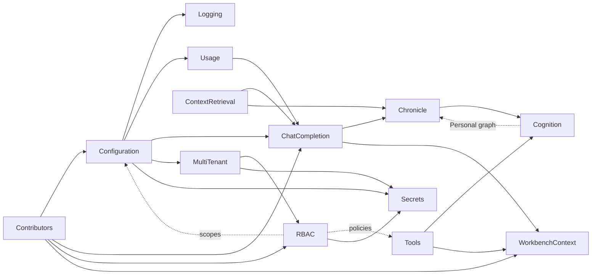

# Build history: dependencies, seams and the tracer-bullet slices

How Foundation was built: the plans' dependencies, the seams that broke their cycles, and the slices built so far, each with what it decided and what it left for later. This is a record. What a feature does now is in its own document ([Index.md](Index.md)), and what is still to do is in [plans/Index.md](plans/Index.md), each plan with its own TODO section. Where this record and a plan's TODO disagree, the plan's TODO is current.

The order is a sequence of **tracer bullets**: thin slices that run end to end through the backend, the REST layer and the UI. Each slice gives the user something real to look at before more is built on it. A slice builds only the part of a plan it needs, and later slices come back to finish it.

## Dependencies

The dotted edges are the **cycles**. Each one is broken with a seam, described below.

## Breaking the cycles
Each cycle is broken by building a **seam** first: a narrow interface or a column that exists from day one. The real implementation then arrives later without touching the callers.

1. **Configuration ↔ MultiTenant/RBAC.** Scopes need identity, and identity's settings (OIDC) live in configuration.
   - *Seam*: the `Configuration` table has its `Scope` column from the start, and v1 writes only `app`.
2. **Every service ↔ RBAC.** Each service must check access, but RBAC comes late.
   - *Seam*: from the first slice, `ServiceArgs` carries a `Principal` (single-user mode: an implicit user and tenant), and every new operation calls `authz.Check`. It allows everything until RBAC lands.
   - New tables get `TenantID`, and `OwnerID` where they are user-owned, even while there is one tenant. Retrofitting ownership later is the expensive path.
3. **Chronicle ↔ Cognition.** *Personal* mode is a Cognition graph, but the node library is shaped by Chronicle's steps.
   - *Seam*: Chronicle's pipeline is first written in Go as separate step functions with typed inputs and outputs (window, retrieve, match, reply, update), each shaped like a node.
   - Cognition then wraps each step as a node, and the built-in *Personal* graph replaces the Go sequence. The same tests prove it behaves identically.
4. **Tools ↔ Cognition.** The `Agent` node runs the tool loop, and tools appear as nodes.
   - *Seam*: `tools.Loop` is built first and called from chat directly. The `Agent` node wraps it later. *Built in slice 8*: chat's `Send` runs the loop, and the `Agent` node (`llm.agent`) wraps it.
5. **ContextRetrieval ↔ Chronicle.** Retrieval fuses Chronicle memory with Volumes.
   - *Seam*: the `retrieval.Source` interface, with only the library (Volumes) source at first.
6. **Contributors ↔ everything.** The registry is needed before any contribution can exist.
   - *Seam*: build the registry with only the points the current slice uses. Convert the hand-wired workbench pieces one at a time, when a slice touches them.
7. **Per-tenant index ↔ the existing index.** Today LanceDB lives in `<data-dir>/lancedb`.
   - *Seam*: the store takes its directory from a resolver. When tenants arrive, the existing directory becomes the default tenant's, with a one-time move.

## Build order: tracer bullets
Each slice ends with something to look at, and the ★ marks where a decision is expected after seeing it.

1. **Seams.** *Built.* A small slice, mostly invisible:
   - the extension registry (frontend and backend) with `workbench.borderTab` and `configuration` (`config.section` on the backend); *built*
   - `Principal` in `ServiceArgs` and the allow-all `authz.Check`; *built*
   - the `TenantID`/`OwnerID` convention (`db.Tenanted`, `db.Owned`, `db.InTenant`); *built*
   - the error and logging conventions: the `logging` builder over `samber/oops`, the request trace middleware (`rest.Middleware`), and `ServiceArgs.Fail`. Every service built afterwards uses them from the start, and the existing services move over. *Built; every existing service has moved over.*
   - DevTools becomes the first `borderTab` contribution, proving the registry. *Built*, with DevTools' Extensions tab listing the browser's and the server's points (`GET /api/v1/extensions/points`, the first operation to call `authz.Check`).
   - What slice 1 decided is recorded in each plan's *Built in slice 1* section: [Contributors.md](Contributors.md#built-in-slice-1), [Logging.md](Logging.md#built-in-slice-1), [MultiTenant.md](MultiTenant.md#built-in-slice-1) and [RBAC.md](RBAC.md#built-in-slice-1).
2. **Settings and levels.** *Built.* ★ the Settings UI.
   - `configservice`, app scope only, with the generic schema form renderer in a Settings border tab; *built*
   - The sections `ai.providers`, `ai.models` (with pricing) and `ai.chat.levels`; *built*. The Gemini key now comes from Settings, and the flag or env var still wins.
   - Usage recording (the provider decorator into `UsageRecord`), with no UI yet; DevTools can show the rows. *Built*, with DevTools' Usage tab.
   - What slice 2 decided is recorded in [Configuration.md](Configuration.md#built-in-slice-2) and [Usage.md](Usage.md#built-in-slice-2).
3. **Logging.** *Built.* ★ the Log Explorer.
   - The VictoriaLogs handler, `scripts/victorialogs.sh`, the `logging` section, and `logsservice`; *built*
   - The Log Explorer with the builder, the LogsQL editor, the histogram and live tail; *built*, with quick filters, *Show this trace*, surrounding records, deep links, and *Show in Log Explorer* from DevTools' Log tab. Saved queries wait.
   - Browser log forwarding (`warn` and above) with a shared trace; *built*. Full logging for one user waits for identity (slice 10).
   - What slice 3 decided is recorded in [Logging.md](Logging.md#built-in-slice-3).
4. **Chat, thin.** *Built.* ★ the chat transcript, composer and level toggle.
   - The AgentOS › Chat editor streams straight from `chatservice`, with no memory; *built*, through the new `conversation` feature's `Send`, with `chatservice` now driven by the chat levels.
   - `Conversation` and `Round` are persisted, and each round's footer shows its tokens and cost; *built*.
   - This converts `workbench.editor`, because Chat and Dashboard are new editors. *Built*: every editor is now a contribution. The Dashboard waits for slice 5.
   - The workbench context store, `useWorkbenchSubject` in the existing editors, and the snapshot sent with `Send` through the `workbench` context provider ([WorkbenchContext.md](WorkbenchContext.md)). Chat can then answer "what is this document about?" with no tools. *Built*, with the snapshot naming what is open (not its content, as proposed).
   - The opt-in debug capture of prompts and replies (Usage question 2); *built*, with DevTools' Usage tab showing a captured call.
   - What slice 4 decided is recorded in [ChatCompletion.md](ChatCompletion.md#built-in-slice-4), [WorkbenchContext.md](WorkbenchContext.md#built-in-slice-4), [Contributors.md](Contributors.md#built-in-slice-4), [Usage.md](Usage.md#built-in-slice-4) and [Configuration.md](Configuration.md#built-in-slice-4).
   - **Blockers**: none. Its one **Before** question (Usage 2) was answered before building.
   - **★ review pending**: the transcript, composer and level toggle still need review with a real model.
     - The build environment had no Gemini API key, so a streamed reply, a generated title and a captured call were never seen in the browser. Every round there ended with the 503 "AI provider is not configured" message, as designed.
     - Set a key in Settings › AI › Providers, then review. See [ChatCompletion.md › Verification of slice 4](ChatCompletion.md#verification-of-slice-4).
   - **Decisions to review after seeing it**:
     - Chat lives in a new `conversation` feature rather than `chronicle`. Chronicle's pipeline will run inside its `Send` in slice 6.
     - Conversations are private to their owner until RBAC.
     - The context controls' defaults are server sections.
     - Each round keeps its own copy of its tokens and cost.
     - The last 50 rounds are sent as plain history until memory arrives.
     - WorkbenchContext questions 1, 2, 3 and 6 are built on their proposals.
5. **Retrieval and feedback.** *Built.* ★ the axis mapping, Top-K and the inspector.
   - The retrieval engine with the library source; *built* (`features/retrieval`, `retrievalservice.Retrieve`, `POST /retrieval/retrieve`), with the RRF shared with `indexservice.Find` (seam 5: `retrieval.source`, with only `library` so far).
   - The RAG Search contribution with the two sliders; inline citations; the Context inspector; *built*, with preset chips (`chat.context.presets`), Top-K as segments, citations as chips that open the file at its lines, and a Sources row.
   - 👍/👎/🚫 with `SegmentFeedback`; *built*, per tenant, with `RoundSegment` recording what each round injected.
   - A first Dashboard widget, *Usage & cost*; *built*, with `usageservice.Summary`, the Dashboard editor and the `dashboard.widget` point.
   - Optionally the Markdown Editor's Chat tab, which reuses the same components. *Not built*: left for a later slice (see below).
   - What slice 5 decided is recorded in [ContextRetrieval.md](ContextRetrieval.md#built-in-slice-5), [ChatCompletion.md](ChatCompletion.md#built-in-slice-5), [Usage.md](Usage.md#built-in-slice-5), [Contributors.md](Contributors.md#built-in-slice-5) and [Configuration.md](Configuration.md#built-in-slice-5).
   - **Blockers**: none. It had no **Before** questions.
   - **★ review pending**: the axis mapping, Top-K and the inspector need review with a real model.
     - The build environment had no Gemini API key. Everything was seen against a local stub of the Gemini API, whose reply always cites `[1][2]`, so how a real model cites (or fails to) is unseen.
     - Set a key in Settings › AI › Providers, then review. See [ContextRetrieval.md › Verification of slice 5](ContextRetrieval.md#built-in-slice-5).
     - With only the library source, the Chronicles ↔ Library dial scales every segment alike, so it changes nothing visible until slice 6 adds Chronicle memory.
   - **Decisions to review after seeing it**:
     - Feedback is per tenant (MultiTenant 1).
     - 👎 keeps the round in the window, and 🚫 removes it and takes back its vote (ContextRetrieval 2).
     - Axis 2 is exponential with B = 4 (ContextRetrieval 1).
     - Top-K means segments; the sampling overrides wait (ChatCompletion gap 6).
     - Without a query embedding, retrieval falls back to keywords rather than failing the round.
     - The context budget is capped at `maxBudgetTokens` (10 000 tokens).
     - Each round stores everything its inspector shows.
   - **Pending, carried forward**
     - The Markdown Editor's Chat tab.
     - The *Flagged segments* widget and listing 👎 rounds for review.
     - Pinned items, the volume filter in the popover, and the context budget control.
     - Hiding Dashboard widgets and saving their layout (`ui.dashboard`), and linking a costly conversation to Chat.
     - Relocating a citation by its `Head`/`Tail` anchors after the file has changed.
     - Index titles: a chunk made of several small sections takes the *last* section's heading, so its citation can be titled by a heading near its end (`mergeSmall` in the chunker).
6. **Chronicle.** *Built.* ★ the side view and the entry editor.
   - Entries, the Chronicles side view (this converts `workbench.sideView`), and stage 1, stage 2 and the memory update as Go step functions (seam 3). *Built*: the `chronicle` feature (`chronicleservice`, LanceDB's `entries` table), the side bar as `workbench.sideView` tabs with an Editors view of `workbench.command`s, the Chronicles view, the entry editor, and `chronicle/steps` (`Candidates`, `Match`, `Update`) run by the `chronicle` context provider and the new `chat.roundFollower` point inside `conversationservice.Send`.
   - The Chronicle source is added to retrieval. *Built*, and RAG Search searches it by default, so the Chronicles ↔ Library dial now has an effect.
   - What slice 6 decided is recorded in [Chronicle.md](Chronicle.md#built-in-slice-6), [ContextRetrieval.md](ContextRetrieval.md#built-in-slice-6), [ChatCompletion.md](ChatCompletion.md#built-in-slice-6), [Contributors.md](Contributors.md#built-in-slice-6), [Configuration.md](Configuration.md#built-in-slice-6) and [Usage.md](Usage.md#built-in-slice-6).
   - **Blockers**: none. It had no **Before** questions.
     - Building: on this 7 GB codespace the linker was killed for lack of memory while linking `out/cli`. `GOGC=25 GOFLAGS=-ldflags=-s backend/scripts/build.sh` links it (no debug symbols); see CLAUDE.md › *Building*.
   - **★ review pending**: the side view and the entry editor need review with a real model.
     - The build environment had no Gemini API key. Everything was seen against a local stub of the Gemini API, whose stage 1 picks the first candidates and whose memory update is canned, so how a real model chooses entries, rewrites summaries and proposes entries is unseen.
     - Set a key in Settings › AI › Providers, chat for a while, then review the Chronicles view, the proposals and the entry editor. See [Chronicle.md › Verification of slice 6](Chronicle.md#built-in-slice-6).
   - **Decisions to review after seeing it** (each in [Chronicle.md](Chronicle.md#decisions-to-review-after-seeing-it)):
     - The pipeline runs inside `conversationservice.Send`: stage 1 as the `chronicle` context provider, the memory update as the `chronicle` round follower.
     - Checked entries are the conversation's settings and active entries the last round's pinned segments, so there is no `ActiveEntry` table.
     - The memory update proposes new entries for the user to accept, and updates used entries directly, keeping the old summaries to restore.
     - Without stage 1 (no key, or off), retrieval's order decides.
     - RAG Search also searches Chronicles, so unchosen entries can still go in, unpinned.
     - One parent per entry, built-in types in code, titles rather than slugs.
     - The window default is 15 rounds (was 50).
     - The side bar is vertical tabs, with an Editors view built from `workbench.command`s.
     - ContextRetrieval 3 (past rounds as a source) and Chronicle's *Volumes as memory* were not built: both answered *(after seeing)* with "not built" for now.
   - **Pending, carried forward**
     - The graph (network) view, and custom entry types with summarizer graphs (slice 7 onwards).
     - Correcting stage 1 by removing a Chronicle chip.
     - Saving Chronicles checkboxes at once (today they are stored with the next message) and storing the memory update's line with its round.
     - Undoing a round's memory changes in one step; editing a past prompt and deleting a round.
     - The `rounds` retrieval source (ContextRetrieval 3), and caching the query embedding that stage 1 and RAG Search each make.
     - The Volumes side view (Volumes stays an editor), and the command palette for `workbench.command`.
     - Carried from slice 5: the Markdown Editor's Chat tab, the *Flagged segments* widget, pinned volume items and the budget control, Dashboard layout, citation relocation, and index titles.
7. **Cognition skeleton.** *Built.* ★ the editor's look and feel.
   - The engine with linear exec flow and pure nodes; *built* (`features/cognition`: the model, validation, `cognition/engine`, the trace tables with retention, `cognitionservice`). Chronicle's steps become nodes, and *Personal* becomes a built-in graph; *built* (`chronicle/nodes`, `personal.json`), run by the `chronicle` context provider and round follower, two traced runs per round.
   - A read-only canvas and the Log Viewer over real traces; *built*, as the Cognition Editor (`src/editors/cognition/`) with the Logic Editor, the Log Viewer, the Details panel (Node, Handle, Handle data) and the Cognition side view (the Explorer).
   - What slice 7 decided is recorded in [Cognition.md](Cognition.md#built-in-slice-7), [Contributors.md](Contributors.md#built-in-slice-7), [Chronicle.md](Chronicle.md#built-in-slice-7), [Usage.md](Usage.md#built-in-slice-7) and [Configuration.md](Configuration.md#built-in-slice-7).
   - **Blockers**: none left. Its one **Before** question (Cognition 2, collaborative graph editing) was answered before building: **shared Yjs documents**. Cognition 4 (template helpers: global, domain ones deferred) and 5 (traces kept for the last N runs *or* N days) were answered at the same time.
   - **★ review pending**: the editor's look and feel needs review with a real model and with use.
     - The build environment had no Gemini API key. Runs were made against a local stub of the Gemini API, so the traces show canned stage 1 choices and memory updates.
     - Seen in a headless browser, light and dark: the canvas, overlays, selection, Handle Data and the Log Viewer. Not yet judged by a person, and not tried on a graph larger than Personal.
     - Chat for a while with a key set, then open AgentOS › Cognition (or the Cognition side view) and review. See [Cognition.md › Verification of slice 7](Cognition.md#built-in-slice-7).
   - **Decisions to review after seeing it** (each in [Cognition.md](Cognition.md#decisions-to-review-after-seeing-it)):
     - Chat runs *Personal* from the `chronicle` provider and follower, two runs per round. `Send` itself is not yet a mode graph.
     - Built-in graphs are code (a new `cognition.graph` point), with no graph table until drafts.
     - `NodeType` is a struct with function fields; data types are a point (`cognition.type`) with colours.
     - Values pass as Go values. Traced values over 256 KB keep a preview, with no blob files.
     - Traces are written when a run ends.
     - Only equal types and `any` connect; there are no implicit conversions.
     - The canvas is read-only at stored positions, and Handle Data follows the selected node to a run that reached it.
   - **Pending, carried forward**
     - The later passes:
       - editing as shared Yjs drafts (Cognition 2), publishing and a graph table;
       - the Prompt Editor and library (with the global helpers of Cognition 4);
       - Debug and Single-step;
       - loops and the iteration picker;
       - Replay.
     - `Send` as a mode graph (`chat.modes`, Stream reply, Emit nodes); the run token and cost limits; implicit conversions; blob files for large values; live traces while running.
     - The Palette side view, `cognition.nodeView`, the toolbar, and a link from a chat round to its runs.
     - Seen while verifying: under a dark browser preference the page body turns dark but the MUI theme stays light, so side-bar headings (the existing *COGNITION* and others) are hard to read. This is app-wide, not new.
     - Carried from slice 6: the graph (network) view and custom entry types with summarizer graphs; chip corrections; saving Chronicles checkboxes at once; undoing a round's memory changes; editing a past prompt and deleting a round; the `rounds` source and the shared query embedding; the Volumes side view and the command palette; and, from slice 5, the Markdown Editor's Chat tab, the *Flagged segments* widget, pinned volume items and the budget control, Dashboard layout, citation relocation and index titles.
8. **Tools.** *Built.*
   - Tool calling in `chatservice`, `tools.Loop`, and `kb.search` and `kb.read`; *built* (`features/tools`, the `tools.tool` point, Gemini function calling), with the rest of Tools 1's first tools: `kb.createNote`, `kb.edit` (live in an open editor through its writer), `chronicle.search`, `chronicle.getEntry`, `chronicle.updateEntry` and `time.now`. Chat's reply is now always the loop.
   - Confirmation cards for write tools; *built*, per call (Tools 2): *Approve*, *Always allow here* (stored on the conversation) and *Deny*, with the change shown in full.
   - Client tools: the pause and resume round trip, `workbench.getState`, `workbench.open` and `chat.askChoice` ([WorkbenchContext.md](WorkbenchContext.md)); *built*, as `tool` SSE events and `POST /conversation/answer`, with the browser's `chat.clientTool` point.
   - Then the `Agent` node; *built* (`llm.agent`): unattended, so writes are left out (denied when listed) and it has no client tools.
   - Also: the ⚙ **Tools** switch (on by default), the `tools` settings section, and tool results cited like retrieval (Tools 3, on its proposal).
   - What slice 8 decided is recorded in [Tools.md](Tools.md#built-in-slice-8), [WorkbenchContext.md](WorkbenchContext.md#built-in-slice-8), [ChatCompletion.md](ChatCompletion.md#built-in-slice-8), [Contributors.md](Contributors.md#built-in-slice-8), [Configuration.md](Configuration.md#built-in-slice-8), [Usage.md](Usage.md#built-in-slice-8) and [Cognition.md](Cognition.md#built-in-slice-8).
   - **Blockers**: none left. Its **Before** questions were answered before building:
     - Tools 1: every candidate tool except Nexus's;
     - Tools 2: confirmation per call, with unattended pre-approved writes left for later;
     - WorkbenchContext 5: contacts are only an illustration, so there are no contact tools.
   - **★ review pending**: the tool cards, the approval flow and *Ask you to choose* need review with a real model.
     - The build environment had no Gemini API key. Everything was seen against a local stand-in for the Gemini API that calls tools from a script, so how a real model chooses tools, phrases arguments, recovers from a failed call and cites tool passages is unseen. Gemini's thought signatures are passed back but untested against the real API.
     - Seen in headless Chromium, light and dark: search with its citation, an edit approved, a choice answered, a file opened, a live edit in an open editor, a note denied.
     - Set a key in Settings › AI › Providers, then try: "find what my notes say about X", "fix the typo in <file>", "add a note about…", and a question about "him" with two people open. See [Tools.md › Built in slice 8](Tools.md#built-in-slice-8).
   - **Decisions to review after seeing it** (each in [Tools.md](Tools.md#decisions-to-review-after-seeing-it)):
     - One `tool` event per status change and one `POST /conversation/answer`, in place of the plan's `clientToolCall` event and `tool-results` route.
     - Client tools are declared with each message, `read` and `ui` only.
     - Tool passages are cited like retrieval, numbered after the context (Tools 3).
     - `kb.search` and `chronicle.search` run retrieval over one source.
     - `kb.edit` is find/replace with a unique match, live through the open editor's writer; `kb.read` returns at most 400 lines.
     - The Tools switch is on by default.
     - Approval waits until the round is stopped.
     - Past rounds are replayed as text, without their tool calls.
     - The cards sit above the reply text.
     - `workbench.open` opens in Chat's tab set, hiding the chat.
     - The Agent leaves out writes unless they are listed.
     - WorkbenchContext 4 (asking) is built on its proposal, with the typed answer in the card.
   - **Pending, carried forward**
     - **From Tools.md**: MCP (Tools 4), web tools, tenant allow and deny rules, rate limits, and unattended pre-approved writes.
     - **More tools**: every tool as a Cognition node, `nexus.read`/`nexus.write` (slice 9), `editor.getSelection` and `workbench.subjectDescriber`.
     - **Showing calls elsewhere**: tool calls in the Log Viewer, and a link from a call to its usage.
     - **Robustness**: waiting calls kept in memory (one server only).
     - **Seen while verifying**: the *Ask you to choose* card can end just below the fold after it loads. The dark-preference contrast issue from slice 7 still applies.
     - **Carried from slice 7**: the Cognition editing passes (Yjs drafts, publishing, the Prompt Editor, debugging, loops, Replay); `Send` as a mode graph; run token and cost limits; the Palette, `cognition.nodeView`, the toolbar and round-to-run links.
     - **Carried from slices 5 and 6**: the Chronicle graph view and custom types, chip corrections, saving checkboxes at once, undoing a round's memory changes, editing a past prompt and deleting a round, the `rounds` source and the shared query embedding, the Volumes side view and the command palette, the Markdown Editor's Chat tab, the *Flagged segments* widget, pinned volume items and the budget control, Dashboard layout, citation relocation and index titles.
9. **Nexus.** *Skipped for now* (2026-10-23): its plan is not fleshed out yet, and its **Before** question (Cognition 1, Nexus storage) is still open. Slice 10 was built first, which the seams allow.
   ★ how streams and reconciliation feel.
   - Streams, the `Reconcile` node and the Nexus tab.
10. **Identity and tenants.** *Built*, ahead of slice 9. ★ sign-in, setup, the account menu and the admin editors.
   - Local login, the JWT, the application and tenant databases, and the per-tenant LanceDB directories; *built* (`features/identity`; `--app-db`; `db.TenantDir` with a one-time move into `lancedb/1`; `entrystore.Tenants`). Login is opt-in: single-user mode lasts until `/setup`. The tenant database is the existing `foundation.db`, with no `db.ForTenant` resolver yet. Volumes stay the default tenant's.
   - The Tenant and User editors, and the account page with the tenant switcher; *built*, as Administration › Tenants and Users (administrators only), an Account editor, and an account menu at the foot of the side bar.
   - Full logging for one user ([Logging.md](Logging.md)); *built*, as the *Full logging* switch in the Users editor. Setting it from the Log Explorer waits.
   - Then OIDC. *Not built*: deferred until the local flow has been seen (MultiTenant 4).
   - What slice 10 decided is recorded in [MultiTenant.md](MultiTenant.md#built-in-slice-10), [Logging.md](Logging.md#built-in-slice-10) and [RBAC.md](RBAC.md#built-in-slice-10).
   - **Blockers**: none left. Its **Before** question was answered before building, together with three questions found while reading the plan:
     - MultiTenant 2: a 15-minute access JWT and a rotating, server-side refresh token;
     - MultiTenant 3: auth is opt-in, and `/setup` makes the first user and tenant with the reserved IDs;
     - MultiTenant 4: OIDC is deferred;
     - MultiTenant 5: an `Admin` flag guards administration until RBAC.
   - **★ review pending**: sign-in, setup, the account menu and the editors need review by a person.
     - Seen in headless Chromium, light theme only: setup from the account menu, the Tenants and Users editors, full logging switched on, a second user signing in (a wrong password first) and seeing neither admin commands nor Volumes, the Account page, and signing out. Every route was also tried with curl.
     - Not seen in the browser: switching tenants (tried through the API only), refreshing after the 15 minutes, a disabled user's session ending, and records actually stored at debug (no VictoriaLogs was running; covered by a test).
     - To review: run `serve` on a copy of your data directory (`--data-dir`), open the workbench, choose *Set up accounts…* in the account menu, then make a second tenant and user. Check that what you made before setup is still yours. See [MultiTenant.md › Built in slice 10](MultiTenant.md#built-in-slice-10).
   - **Decisions to review after seeing it** (each in [MultiTenant.md](MultiTenant.md#decisions-to-review-after-seeing-it), [Logging.md](Logging.md#built-in-slice-10) and [RBAC.md](RBAC.md#built-in-slice-10)):
     - **Tokens**: a 15-minute access token and a 30-day refresh token, with a 30-second grace for concurrent refreshes.
     - **Databases**: the tenant database is today's `foundation.db`, and app-scope settings stay in it.
     - **Volumes** are only the default tenant's.
     - **Switching tenants** reloads the page.
     - **The Account page** is an editor, not a route.
     - **Users** are disabled, not deleted. A deleted tenant's content is kept, unreachable.
     - **Account rules**: passwords need 8 characters or more, and usernames are 3 to 64 of `a-z 0-9 . _ -`.
     - **Admin-only, beyond the answer**: `logs.readAll` and app-scope `config.write` are admin-only too.
     - **Browser log level**: the browser polls for its own level every 5 minutes.
   - **Pending, carried forward**
     - **From MultiTenant.md**:
       - OIDC;
       - per-tenant knowledge base roots, so other tenants get Volumes;
       - the `db.ForTenant` resolver, and app-scope settings in the application database;
       - purging a deleted tenant's data;
       - the global tenant and Chronicle sharing (slice 11);
       - rate limiting sign-in;
       - invitations and password reset by email;
       - refreshing from the `fetch` streaming clients on a 401;
       - checking `PolicyVersion` per request.
     - **From Logging.md**: setting full logging from the Log Explorer.
     - **Seen while verifying**: the rename dialog's button says *Create* (it reuses `NameDialog`). The dark-preference contrast issue from slice 7 still applies, since no MUI theme follows the preference.
     - **Carried from slice 8 and earlier**: unchanged; see slice 8's list.
11. **RBAC.** *Built.* ★ the built-in roles and the permission matrix.
    - The real `authz.Check`, the Role Editor and the Share dialog; *built*:
      - `features/authz`: the `authz.resourceType` point, built-in roles defined by action classes, custom tenant roles, `RoleGrant` and `AccessAudit` in the application database, and an installed `Policy`;
      - `authzservice` under `/authz`, and `useCan` in the browser;
      - Administration › Roles (the matrix, grants and an Access checker), and the Share dialog on Volumes and tenants.
      - Volumes are checked per Volume, and a *Viewer* opens files read-only.
    - Tenant and user scopes in Settings; *built*, with read-only sections where you may not write, and the browser reading settings at the user scope.
    - The moderation queue and Chronicle sharing; *built*: sharing with the tenant at once, or globally after a tenant moderator and then a global moderator approve, into the reserved global tenant (ID 2). The queue is Administration › Moderation.
    - Slice 10's `Admin` flag became grants, once: flagged users became *Super Administrator*, members *Editor*.
    - What slice 11 decided is recorded in [RBAC.md](RBAC.md#built-in-slice-11), [MultiTenant.md](MultiTenant.md#built-in-slice-11), [Chronicle.md](Chronicle.md#built-in-slice-11), [Configuration.md](Configuration.md#built-in-slice-11), [Contributors.md](Contributors.md#built-in-slice-11) and [Logging.md](Logging.md#built-in-slice-11).
    - **Blockers**: none left. Its **Before** questions were answered before building, together with one found while reading the plan:
      - RBAC 1: as proposed (*Super Administrator* writes the app scope, *Owner* and *Administrator* a tenant's, everyone their own);
      - RBAC 2: allow-only;
      - RBAC 5: *Tenant Administrator* manages tenants without reading their content;
      - RBAC 7 (new): the `Admin` flag becomes *Super Administrator*, and *Application Administrator* is a separate, secrets-only role (Secrets 5 answered with it). New members get *Editor*, and a tenant's creator *Owner*.
    - **★ review pending**: the roles and the matrix need review by a person, and with more than one tenant in use.
      - Seen in headless Chromium, light theme only:
        - the Role Editor: a built-in role's matrix, its grants, a custom role duplicated and saved, the Access checker;
        - the Tenants editor's *Roles…*, and a Volume's Share dialog;
        - Settings at App, read-only for an *Editor*, and at User;
        - a Chronicle shared globally from the entry editor, and the moderation queue;
        - a *Viewer*'s Markdown file opened read-only.
      - Also walked through with curl across two tenants, including the global copy found by retrieval in the other tenant.
      - Not seen in the browser: dark theme, the Tenants editor as a tenant *Administrator* (not a *Tenant Administrator*), a grant expiring, and a read-only viewer handing the writer role to an editor who joins later (covered by the room logic, not by a test).
      - To review: run `serve` on a copy of your data directory. The first start migrates the `Admin` flag and re-embeds every Chronicle entry, since the entries table gained a column. Then open Administration › Roles, share a Volume with a second user as *Viewer*, and share a Chronicle entry globally with two moderators. See [RBAC.md › Built in slice 11](RBAC.md#built-in-slice-11).
    - **Decisions to review after seeing it** (each in [RBAC.md](RBAC.md#decisions-to-review-after-seeing-it) and [MultiTenant.md](MultiTenant.md#built-in-slice-11)):
      - **Roles**:
        - *Administrator* holds every tenant permission but deleting, so it can grant *Editor* under the no-escalation rule.
        - Built-in roles are defined by action classes.
        - Granting or revoking a role needs every permission in it.
      - **What needs no grant**: personal resources (your conversations and Chronicles, your account, reading settings) need only membership.
      - **Logs**: `logs.read` needs *Owner* or *Administrator*; every member could read the tenant's logs before.
      - **Managing grants**: only from within the tenant, and only for members.
      - **Volumes**:
        - A Volume grant only adds access: browsing folders needs `kb.read` on the tenant.
        - A read-only file is enforced by the room dropping the viewer's updates.
      - **Settings**: the browser reads settings at the user scope.
      - **Chronicle sharing**:
        - The global tenant has no row and no members.
        - The global copy is a snapshot of title and summaries.
        - The two approvals must come from two people.
        - Sharing with the tenant needs no approval.
      - **Audit**: every denied check of a changing action is audited, unthrottled.
      - **DTOs**: `admin` became `superAdmin`.
    - **Pending, carried forward**
      - **From RBAC.md**:
        - groups (RBAC 3) and custom app-level roles (RBAC 4);
        - the audit viewer and `PolicyVersion` checks;
        - shares on files, graphs and Nexuses;
        - `authz.Filter`;
        - enforcing `usage.viewAll`, `tool.execute` and `tool.approveWrite`;
        - adding members without `user.list` (invitations).
      - **From MultiTenant.md and Chronicle.md**:
        - flagged segments in the moderation queue;
        - updating a global copy when its entry changes;
        - sharing an entry's children;
        - purging a deleted tenant's data, including its grants' audit.
      - **Seen while verifying**: the dark-preference contrast issue from slice 7 still applies. The matrix scrolls sideways on narrow editors.
      - **Building**: the linker can be killed for memory while the vite dev server and `serve` run, even for `--test`. Stop them, or use `GOFLAGS=-ldflags=-s`.
      - **Carried from slice 10 and earlier**: unchanged; see slices 10 and 8.
12. **Secrets from Vault.** *Built.* ★ the sealed start and the Secrets editor ([Secrets.md](Secrets.md)).
    - `serve --vault-addr` starts sealed: it opens its port, waits for a token, and then reads its secrets from HashiCorp Vault. *Built* (`features/secrets`: `Bootstrap`, `Gate`, the small `vault` client), with `/bootstrap/status|unseal`, a `degraded` state that recovers by itself, and the browser's sealed page (`SealedGate`).
    - `SecretStore`, with `vaultstore` replacing the key-file cipher, and `cli secrets migrate`; *built*, with `cli secrets rekey`. The database key is Vault's `server/db-key`.
    - The scripts in `backend/scripts/secrets/`: dev Vault, init, set, list, rotate, delete and unseal; *built*, on `curl` and `jq`.
    - `secretsservice` and the write-only Secrets editor, mostly for Application Administrators; *built*, as Administration › Secrets. Some configuration (such as model API keys) can be user configured and should be stored as secrets as well; *built* (Secrets 7): `ai.providers` takes keys at the app, tenant and user scopes, each call uses its principal's, and all go through `SecretStore`.
    - What slice 12 decided is recorded in [Secrets.md](Secrets.md#built-in-slice-12), [Configuration.md](Configuration.md#built-in-slice-12) and [RBAC.md](RBAC.md#built-in-slice-12).
    - **Blockers**: none left. Its **Before** question was answered before building, together with one found while reading the slice:
      - Secrets 1: a response-wrapped, single-use AppRole SecretID, made by `unseal.sh`;
      - Secrets 7 (new): provider keys at the app, tenant and user scopes, the narrowest winning. You write your own, a tenant's *Owner* or *Administrator* the tenant's, and an *Application Administrator* the app's.
    - **★ review pending**: the sealed start and the Secrets editor need review by a person.
      - Seen against a dev Vault in Docker: migrating a key-file data directory, the sealed start (503, the HTML page, a refused token), `unseal.sh`, the editor's writes, an *Editor* and an *Application Administrator* with curl, losing Vault (paused, then the token revoked) and recovering, and `rotate-db-key.sh`.
      - Seen in headless Chromium, light theme: the sealed page continuing after `unseal.sh`, the Secrets editor (wide and narrow), *Set…*, Settings at App and User, Settings as an *Editor* ("Managed by an Application Administrator", no Secrets command) and as an *Application Administrator*. A value set was in neither the page nor DevTools' Network tab.
      - Not seen: a real Gemini call with a user's own key (no key in this environment), the dark theme beyond the known app-wide issue, a Vault with TLS, and a server running past one token period (1 hour).
      - To review: `eval "$(backend/scripts/secrets/vault-dev.sh)"`, `backend/scripts/secrets/init.sh`, `cli secrets migrate --data-dir <a copy of your data directory>`, then `serve --data-dir <the copy> --vault-addr $VAULT_ADDR` and `backend/scripts/secrets/unseal.sh`. Open Administration › Secrets, and set your own key in Settings › AI › Providers at *User*. See [Secrets.md › Verification of slice 12](Secrets.md#verification-of-slice-12).
    - **Decisions to review after seeing it** (each in [Secrets.md](Secrets.md#decisions-to-review-after-seeing-it)):
      - **Starting**: `--vault-addr` defaults to `$FOUNDATION_VAULT_ADDR`, not `$VAULT_ADDR`; unseal takes the role ID with the token; the server listens before startup is done, answering 503 `server_starting`.
      - **The bundle**: a folder of one-value secrets under `server/`, read once at unseal, so server secrets apply at the next start; `server/gemini-api-key` sits under stored keys rather than over them; the signing key stays in the application database, sealed with `server/db-key`.
      - **Who writes**: an *Application Administrator* writes the app scope's secrets (through Settings and the editor) but no other app setting; a user's own key is used for their calls, and indexing uses the default tenant's.
      - **Losing Vault**: a degraded server recovers by itself when its token renews (Secrets 6, on its proposal).
      - **Showing secrets**: no hint with Vault (Secrets 4, on its proposal); unsealing is script-only (Secrets 3, on its proposal).
      - **Audit**: Settings' secret writes are logged but not in `SecretAudit`.
    - **Pending, carried forward**
      - **From Secrets.md**: `--vault-token-file` for unattended restarts (Secrets 2, not built), re-reading the bundle without a restart, TLS options and namespaces for Vault, and an audit viewer for `SecretAudit`.
      - **Seen while verifying**: the scope selector's *App* tooltip says "read-only for you" to an *Application Administrator*, who may write its secrets. A read-only field still shows its reset button (from slice 11). The dark-preference contrast issue from slice 7 still applies.
      - **Building**: as in slice 11, link with `GOGC=25 GOFLAGS=-ldflags=-s` while other large processes run.
      - **Carried from slice 11 and earlier**: unchanged; see slices 11, 10 and 8.

Slices 10 and 11 can move earlier at any point, because the seams from slice 1 keep everything after them unchanged. Move them up if multi-user use is needed sooner.

## Questions by slice
Which open questions each slice needed answered (the open ones are now in each plan's TODO). **Before** means the slice cannot start without the answer. **After seeing** means building on the proposal is fine, and the answer comes once there is something to look at.

| Slice | Before | After seeing |
|---|---|---|
| 1. Seams | none | – |
| 2. Settings and levels | none (all answered) | Usage 1 (currency) |
| 3. Logging | none (all answered) | – |
| 4. Chat, thin | none (Usage 2 answered: an opt-in debug capture) | ChatCompletion gap 4 (auto level routing) can wait; WorkbenchContext 1 (snapshot size), 2 (recent history), 3 (editor content) and 6 (browser tabs), built on their proposals |
| 5. Retrieval and feedback | none | ContextRetrieval 1 (Axis 2) and 2 (thumbs down); ChatCompletion gap 6 (Top-K); MultiTenant 1 (feedback scope); all built on their proposals, to decide after seeing |
| 6. Chronicle | none | ContextRetrieval 3 (past rounds) and Chronicle (Volumes as memory), both not built for now; the decisions in [Chronicle.md](Chronicle.md#decisions-to-review-after-seeing-it), to review after seeing |
| 7. Cognition | none (Cognition 2 answered: shared Yjs drafts) | Cognition 4 (global helpers) and 5 (last N runs or N days), answered before building |
| 8. Tools | none (Tools 1 answered: every candidate but Nexus's; Tools 2: per call; WorkbenchContext 5: only an illustration) | Tools 3 (citing results) and WorkbenchContext 4 (asking), both built on their proposals, to decide after seeing; the decisions in [Tools.md](Tools.md#decisions-to-review-after-seeing-it) |
| 9. Nexus | Cognition 1 (Nexus storage), still open: skipped for now | Cognition 3 (background runs) |
| 10. Identity | none (MultiTenant 2 answered: 15-minute JWT plus rotating refresh token; 3: opt-in auth with `/setup`; 4: OIDC deferred; 5: an `Admin` flag until RBAC) | the decisions in [MultiTenant.md](MultiTenant.md#decisions-to-review-after-seeing-it), to review after seeing |
| 11. RBAC | none (RBAC 1 answered: as proposed; 2: allow-only; 5: no content; 7, found while reading: the `Admin` flag becomes *Super Administrator*) | RBAC 3 (groups, not built), 4 and 6 (built on their proposals); the decisions in [RBAC.md](RBAC.md#decisions-to-review-after-seeing-it), to review after seeing |
| 12. Secrets from Vault | none (Secrets 1 answered: a wrapped, single-use SecretID; 7, found while reading: keys at every scope; 5 was answered with RBAC 7 before slice 11) | Secrets 3, 4 and 6 (built on their proposals) and 2 (not built); the decisions in [Secrets.md](Secrets.md#decisions-to-review-after-seeing-it), to review after seeing |

