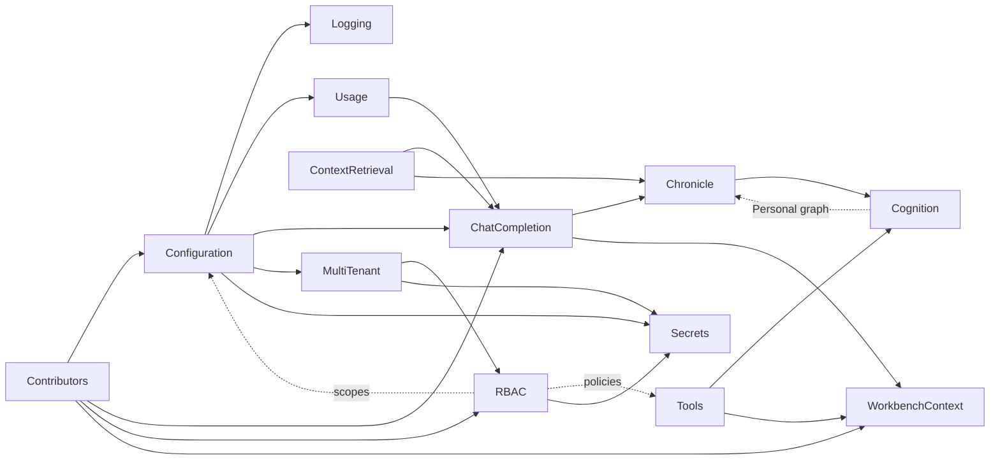

# Plans: index, dependencies and build order

Every plan document, how they depend on each other, and the order to build them in. Open questions are indexed in [TODO.md](TODO.md).

The order is a sequence of **tracer bullets**: thin slices that run end to end through the backend, the REST layer and the UI. Each slice gives the user something real to look at before more is built on it. Plans are rarely finished in one go. A slice builds only the part of a plan it needs, and later slices come back to finish it. Expect the plans to change after each slice.

## The plans

| Plan | Status | Depends on |
|---|---|---|
| [DevTools.md](DevTools.md) | built | – |
| [markdown-editor/MarkdownEditor.md](markdown-editor/MarkdownEditor.md) | built | – |
| [AIChatEmbed.md](AIChatEmbed.md) | built | – |
| [Contributors.md](Contributors.md) | partly built (slice 1: the registry, `workbench.borderTab`, `configuration`; slice 2: Settings as a border tab, the first `config.section` contributions) | – |
| [Logging.md](Logging.md) | partly built (slice 1: the builder, the request middleware, `Fail`) | DevTools (the field model); Configuration for the VictoriaLogs location (a flag until then) |
| [Configuration.md](Configuration.md) | partly built (slice 2: `configservice`, the Settings tab, `ai.providers`, `ai.models`, `ai.chat.levels`) | Contributors; MultiTenant and RBAC for scopes beyond app |
| [Usage.md](Usage.md) | partly built (slice 2: recording, `usageservice.Records`, DevTools' Usage tab) | Configuration (pricing) |
| [ChatCompletion.md](ChatCompletion.md) | planned | Contributors, Configuration, Usage; ContextRetrieval and Chronicle for memory |
| [ContextRetrieval.md](ContextRetrieval.md) | planned | the index (built); Chronicle for its memory source |
| [Chronicle.md](Chronicle.md) | planned | ContextRetrieval, ChatCompletion; becomes a Cognition graph |
| [Cognition.md](Cognition.md) | planned | Chronicle (its first graph), Configuration; Tools for the `Agent` node |
| [Tools.md](Tools.md) | draft | AIChatEmbed (tool calling in `chatservice`); RBAC for policies |
| [MultiTenant.md](MultiTenant.md) | draft; seams built (slice 1: `Principal`, `TenantID`/`OwnerID`) | Configuration (OIDC settings) |
| [RBAC.md](RBAC.md) | draft; seam built (slice 1: allow-all `authz.Check`) | MultiTenant, Contributors (resource types) |
| [WorkbenchContext.md](WorkbenchContext.md) | draft | Contributors, ChatCompletion (`Send`, context providers); Tools for client tools |
| [Secrets.md](Secrets.md) | draft | Configuration (`secret` fields); MultiTenant (identity) and RBAC (the Application Administrator role) |

The dotted edges are the **cycles**. Each one is broken with a seam, described below.

## Breaking the cycles
Each cycle is broken by building a **seam** first: a narrow interface or a column that exists from day one. The real implementation then arrives later without touching the callers.

1. **Configuration ↔ MultiTenant/RBAC.** Scopes need identity, and identity's settings (OIDC) live in configuration.
   - *Seam*: the `Configuration` table has its `Scope` column from the start, and v1 writes only `app`.
2. **Every service ↔ RBAC.** Each service must check access, but RBAC comes late.
   - *Seam*: from the first slice, `ServiceArgs` carries a `Principal` (single-user mode: an implicit user and tenant), and every new operation calls `authz.Check`. It allows everything until RBAC lands.
   - New tables get `TenantID`, and `OwnerID` where they are user-owned, even while there is one tenant. Retrofitting ownership later is the expensive path.
3. **Chronicle ↔ Cognition.** *Personal* mode is a Cognition graph, but the node library is shaped by Chronicle's steps.
   - *Seam*: Chronicle's pipeline is first written in Go as separate step functions with typed inputs and outputs (window, retrieve, match, reply, update), each shaped like a node.
   - Cognition then wraps each step as a node, and the built-in *Personal* graph replaces the Go sequence. The same tests prove it behaves identically.
4. **Tools ↔ Cognition.** The `Agent` node runs the tool loop, and tools appear as nodes.
   - *Seam*: `tools.Loop` is built first and called from chat directly. The `Agent` node wraps it later.
5. **ContextRetrieval ↔ Chronicle.** Retrieval fuses Chronicle memory with Volumes.
   - *Seam*: the `retrieval.Source` interface, with only the library (Volumes) source at first.
6. **Contributors ↔ everything.** The registry is needed before any contribution can exist.
   - *Seam*: build the registry with only the points the current slice uses. Convert the hand-wired workbench pieces one at a time, when a slice touches them.
7. **Per-tenant index ↔ the existing index.** Today LanceDB lives in `<data-dir>/lancedb`.
   - *Seam*: the store takes its directory from a resolver. When tenants arrive, the existing directory becomes the default tenant's, with a one-time move.

## Build order: tracer bullets
Each slice ends with something to look at, and the ★ marks where a decision is expected after seeing it.

1. **Seams.** *Built.* A small slice, mostly invisible:
   - the extension registry (frontend and backend) with `workbench.borderTab` and `configuration` (`config.section` on the backend); *built*
   - `Principal` in `ServiceArgs` and the allow-all `authz.Check`; *built*
   - the `TenantID`/`OwnerID` convention (`db.Tenanted`, `db.Owned`, `db.InTenant`); *built*
   - the error and logging conventions: the `logging` builder over `samber/oops`, the request trace middleware (`rest.Middleware`), and `ServiceArgs.Fail`. Every service built afterwards uses them from the start, and the existing services move over. *Built; every existing service has moved over.*
   - DevTools becomes the first `borderTab` contribution, proving the registry. *Built*, with DevTools' Extensions tab listing the browser's and the server's points (`GET /api/v1/extensions/points`, the first operation to call `authz.Check`).
   - What slice 1 decided is recorded in each plan's *Built in slice 1* section: [Contributors.md](Contributors.md#built-in-slice-1), [Logging.md](Logging.md#built-in-slice-1), [MultiTenant.md](MultiTenant.md#built-in-slice-1) and [RBAC.md](RBAC.md#built-in-slice-1).
2. **Settings and levels.** *Built.* ★ the Settings UI.
   - `configservice`, app scope only, with the generic schema form renderer in a Settings border tab; *built*
   - The sections `ai.providers`, `ai.models` (with pricing) and `ai.chat.levels`; *built*. The Gemini key now comes from Settings, and the flag or env var still wins.
   - Usage recording (the provider decorator into `UsageRecord`), with no UI yet; DevTools can show the rows. *Built*, with DevTools' Usage tab.
   - What slice 2 decided is recorded in [Configuration.md](Configuration.md#built-in-slice-2) and [Usage.md](Usage.md#built-in-slice-2).
3. **Logging.** ★ the Log Explorer.
   - The VictoriaLogs handler, `scripts/victorialogs.sh`, the `logging` section, and `logsservice`.
   - The Log Explorer with the builder, the LogsQL editor, the histogram and live tail.
   - Browser log forwarding (`warn` and above) with a shared trace. Full logging for one user waits for identity (slice 10).
4. **Chat, thin.** ★ the chat transcript, composer and level toggle.
   - The AgentOS › Chat editor streams straight from `chatservice`, with no memory.
   - `Conversation` and `Round` are persisted, and each round's footer shows its tokens and cost.
   - This converts `workbench.editor`, because Chat and Dashboard are new editors.
   - The workbench context store, `useWorkbenchSubject` in the existing editors, and the snapshot sent with `Send` through the `workbench` context provider ([WorkbenchContext.md](WorkbenchContext.md)). Chat can then answer "what is this document about?" with no tools.
5. **Retrieval and feedback.** ★ the axis mapping, Top-K and the inspector.
   - The retrieval engine with the library source.
   - The RAG Search contribution with the two sliders; inline citations; the Context inspector.
   - 👍/👎/🚫 with `SegmentFeedback`.
   - A first Dashboard widget, *Usage & cost*.
   - Optionally the Markdown Editor's Chat tab, which reuses the same components.
6. **Chronicle.** ★ the side view and the entry editor.
   - Entries, the Chronicles side view (this converts `workbench.sideView`), and stage 1, stage 2 and the memory update as Go step functions (seam 3).
   - The Chronicle source is added to retrieval.
7. **Cognition skeleton.** ★ the editor's look and feel.
   - The engine with linear exec flow and pure nodes. Chronicle's steps become nodes, and *Personal* becomes a built-in graph.
   - A read-only canvas and the Log Viewer over real traces.
   - Then in later passes:
     - editing, drafts and publish;
     - the Prompt Editor and library;
     - Debug and Single-step;
     - loops and the iteration picker;
     - Replay.
8. **Tools.**
   - Tool calling in `chatservice`, `tools.Loop`, and `kb.search` and `kb.read`.
   - Confirmation cards for write tools.
   - Client tools: the pause and resume round trip, `workbench.getState`, `workbench.open` and `chat.askChoice` ([WorkbenchContext.md](WorkbenchContext.md)).
   - Then the `Agent` node.
9. **Nexus.** ★ how streams and reconciliation feel.
   - Streams, the `Reconcile` node and the Nexus tab.
10. **Identity and tenants.**
   - Local login, the JWT, the application and tenant databases, and the per-tenant LanceDB directories.
   - The Tenant and User editors, and the account page with the tenant switcher.
   - Full logging for one user ([Logging.md](Logging.md)).
   - Then OIDC.
11. **RBAC.** ★ the built-in roles and the permission matrix.
    - The real `authz.Check`, the Role Editor and the Share dialog.
    - Tenant and user scopes in Settings.
    - The moderation queue and Chronicle sharing.
12. **Secrets from Vault.** ★ the sealed start and the Secrets editor ([Secrets.md](Secrets.md)).
    - `serve --vault-addr` starts sealed: it opens its port, waits for a token, and then reads its secrets from HashiCorp Vault.
    - `SecretStore`, with `vaultstore` replacing the key-file cipher, and `cli secrets migrate`.
    - The scripts in `backend/scripts/secrets/`: dev Vault, init, set, list, rotate, delete and unseal.
    - `secretsservice` and the write-only Secrets editor, for Application Administrators only.

Slices 10 and 11 can move earlier at any point, because the seams from slice 1 keep everything after them unchanged. Move them up if multi-user use is needed sooner.

## Questions by slice
Which open questions ([TODO.md](TODO.md)) each slice needs answered. **Before** means the slice cannot start without the answer. **After seeing** means building on the proposal is fine, and the answer comes once there is something to look at.

| Slice | Before | After seeing |
|---|---|---|
| 1. Seams | none | – |
| 2. Settings and levels | none (all answered) | Usage 1 (currency) |
| 3. Logging | none (all answered) | – |
| 4. Chat, thin | Usage 2 (prompt text in usage records); Logging already rules out logging prompts | ChatCompletion gap 4 (auto level routing) can wait; WorkbenchContext 1 (snapshot size), 2 (recent history), 3 (editor content) and 6 (browser tabs) |
| 5. Retrieval and feedback | – | ContextRetrieval 1 (Axis 2) and 2 (thumbs down); ChatCompletion gap 6 (Top-K); MultiTenant 1 (feedback scope) |
| 6. Chronicle | – | ContextRetrieval 3 (past rounds); Chronicle (Volumes as memory) |
| 7. Cognition | Cognition 2 (collaborative graph editing) | Cognition 4 (template helpers) and 5 (trace retention) |
| 8. Tools | Tools 1 (first tools) and 2 (confirmation); WorkbenchContext 5 (the example domain), if contact tools are among the first | Tools 3 (citing results); WorkbenchContext 4 (asking) |
| 9. Nexus | Cognition 1 (Nexus storage) | Cognition 3 (background runs) |
| 10. Identity | MultiTenant 2 (JWT lifetime) | – |
| 11. RBAC | RBAC 1 (who edits settings), 2 (deny rules), 5 (Tenant Administrator and content) | RBAC 3, 4 and 6 |
| 12. Secrets from Vault | Secrets 1 (token form) and 5 (Application Administrator) | Secrets 2, 3, 4 and 6 |

**Later, not yet placed**: budgets and alerts; MCP; background and scheduled runs; usage retention and roll-ups; runtime plugins; editing documents with the AI.

## Editors and views
Workbench surfaces, existing and planned. The last group are ones no plan has discussed yet.

**Built**: Volumes, Volume, Markdown Editor (Live Preview, Source, WYSIWYG), DevTools (a `workbench.borderTab` contribution, with Network, Log, Extensions and Usage tabs), Settings (a `workbench.borderTab` contribution with the generic schema form).

**Planned in a plan**

| Surface | Plan |
|---|---|
| Custom Settings editors for the model catalog and pricing, if the generic form is not enough | [Configuration.md](Configuration.md) |
| Secrets editor (Administration, write-only); the sealed-server page | [Secrets.md](Secrets.md) |
| AgentOS › Chat; the Markdown Editor's Chat tab | [ChatCompletion.md](ChatCompletion.md) |
| Dashboard | [Usage.md](Usage.md) |
| Chronicles side view; Chronicle entry editor; graph (network) view | [Chronicle.md](Chronicle.md) |
| Cognition Editor: Logic Editor, Log Viewer, Prompt Editor, Nexus tab; Explorer and Palette side views | [Cognition.md](Cognition.md) |
| Role Editor; Share dialog | [RBAC.md](RBAC.md) |
| Log Explorer (structured builder and LogsQL editor) | [Logging.md](Logging.md) |

**Not yet discussed: candidates**
- **Tenant editor** (Administration): list, create and delete tenants, their members and their settings.
- **User editor** (Administration): invite users, disable accounts, reset passwords, and see a user's memberships and grants.
- **Account page**: your own profile, password, linked OIDC identities, user-scope settings and the tenant switcher.
- **Moderation queue**: Chronicle entries waiting for global-share approval, and segments flagged by 👎 *Incorrect*.
- **Conversation history**: search, reopen, rename, export and delete past conversations, beyond the continuous scroll in Chat.
- **Audit log viewer**: configuration revisions, grant changes, denied access, and tool-call approvals. It could be a saved view in the Log Explorer if audit records are also logged.
- **Index administration**: indexing health, files pending, failed files, reindex, and the effect of an embedding-model change.
- **Tools and MCP manager**: tenant tool policies and the registry of MCP servers.
- **Runs and schedules**: Cognition runs across all graphs, and schedules, if background runs are approved.
- **Budgets**: limits and alerts per tenant and user, when budgets arrive.
- **Notifications**: approvals waiting, runs finished, budget warnings, shares accepted.
